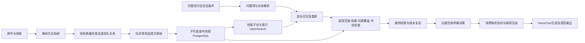

# 企业知识库与证据交付重构设计

状态：用户已批准编码；实施进度见任务板，尚未整体实现。日期：2026-10-26。

审查基线：CueKB [`1d483fc`](https://github.com/ttonghao-thao/CueKB/tree/1d483fcf75473ee36e95e73fdeac6c9d4cca035f)；voice-service-agent [`986f442`](https://github.com/ttonghao-thao/voice-service-agent/tree/986f442d348a9b0c0c52d61f9f22d5ce51e13aca)。本轮读取实际源码、生成契约和调用方既有现场记录，并核对公开项目资料；没有运行生产检索、GPU推理或产品回归。图中的系统边界用于理解需求，不证明现场部署身份。

## 1. 结论与重构边界

当前实现有可靠的权限、版本、任务与可追溯检索基础，但仍是“候选片段检索＋产品归属审核”，没有完成企业RAG需要的“问题适用性判断＋最小充分证据交付”。继续加产品正则、增加top_k或提示模型不要再查，不能解决这个架构缺口。

建议重构三部分：

1. **知识模型**：从产品事实中心改为通用文档结构中心。保留完整原文树、类型化关系和可选业务实体；产品只是一个领域插件。
2. **检索交付**：将候选检索与最终证据决策分开；输出按问题组织、附带必要限定的证据包，明确支持哪些问题、缺哪些信息、是否需要用户选择。
3. **语音集成**：调用方使用同一证据契约，按明确状态控制补查；工具结果注入的性能作为独立架构门槛，不能把逐token消费都称为LLM思考。

保留PostgreSQL权威库、OpenSearch混合召回、幂等Worker/outbox、不可变版本、最终权限复验；不以“重构”为由替换这些已合理的基础。重写文档中间表示、发布资格、证据组构造和消费契约。默认不引入生成式回答服务、图数据库或新的消息系统。

准确性必须分层承诺：系统可验证来源、版本、权限、引用一致性及已识别条件完整性；可用标注集测量相关性和证据支持率；**不能从top1分数、人工归属确认或检索成功推出原文事实绝对真实**。`supported`只表示授权来源支持当前问题，不表示世界事实真实性证明。

## 2. 审查发现及证据

### 2.1 CueKB与调用方的实际缺口

| 缺口编号 | 优先级 | 发现与源码依据 | 对用户目标的影响 | 设计处置 |
| --- | --- | --- | --- | --- |
| F01 | P0 | CueKB `schemas.py:288`新增`fact_kind/dependency_issues`；`V2ContextPart`新增`applicability/link_provenance`；diagnostics新增`selection`。调用方`tools/schemas.py`缺这些字段，`evidence_types.py:13`禁止未知字段 | 两仓当前main的严格响应契约不兼容；可能先发生解析失败，尚未到LLM。静态schema对比已确认，不声称现场错误一定由此导致 | 联合契约门禁、同步DTO；新证据包独立端点与显式契约修订，不能简单忽略全部未知字段 |
| F02 | P0 | `retrieval_v2.py:796`始终返回`EvidenceStatus.UNASSESSED`；`selection.coverage_assessment`同样只支持unassessed | 排序后仍把相关性、条件、冲突和问题覆盖判断留给Nano | 独立证据评估与决策层，状态定义见第6节 |
| F03 | P1 | `schemas.py:236`默认ranked；相关性校准只在adaptive选择中使用。调用方`adapters.py:171`不发送adaptive、selection_query或query_facets | 已有六项优化中动态选择/校准并未在该消费链路启用；并非全部优化失效，但不能按“已实现”推定端到端生效 | 新证据端点固化评估流程，底层搜索保留诊断用途；上线检查实际执行配置 |
| F04 | P1 | `fact_rules.py:14`固定产品属性词；catalog只接受product/bundle/model；`review_rules.py:14`阻塞未确认或非general的unknown | 产品手册规则不是通用企业知识模型。制度、流程、合同、故障说明不应为了发布被迫绑定产品或标成general | 实体类型可选、结构与业务归属分离、风险驱动审核 |
| F05 | P1 | `parsing.py`保留标题、表格与spans；但分块主要受字符数控制，`structure.py`必要章节识别依赖有限标题/引用规则 | 已改善标题与单品隔离，仍无法完整表达跨页表头、流程步骤、脚注、跨文档版本和隐含范围；盲目原子化会割裂条件 | 文档树＋检索子块＋证据组分层；显式关系先行，隐含关系保留疑点 |
| F06 | P1 | `_select_groups`提供预算与已知依赖组，但无通用属性级支持/冲突裁决 | “上下文完整”只说明已知链接齐全；不能说明所有必要条件都被识别，也不能说明回答全部问题 | 区分结构完整性、问题支持性和评估覆盖范围 |
| F07 | P1 | 调用方`native_input.py:120`首次有证据且未终态时总设`search_state=available`，允许模型为缺失细节再查 | 模型需自行推断缺什么；首查丢属性会增加重复注入机会。已有每输入2次上限和相同参数去重，不是无限循环 | 结构化问题项与服务端决策；默认一次检索，明确可恢复缺口才允许一次有目标的补查 |
| F08 | P1 | 调用方`cuekb_evidence.py:10`要求使用所有已返回片段；`model_source`虽已去除分数/ID，但无主证据与问题项映射 | 5段文本的意义不明确；评论、产品介绍可能挤占真正答案，要求“用所有片段”增加负担 | 只注入选中的回答证据；其他候选留审计，不要求逐条使用 |
| F09 | P1 | 调用方`evidence.py:24`扫描所有来源的not/only/unless，检查回答是否出现对应词 | 与所问事实无关的比较段也可能触发缺条件；词出现也不能证明数值、比例和归属正确 | 按回答主张及其引用关系校验；词法检查仅作明确规则项，不标成语义认证 |
| F10 | P1 | VoiceChat快照`model.py:1852`逐token调用引擎；最新优化仍保留该协议 | 检索100ms量级也可能遇到十几秒结果消费；仅换检索算法不足以实现低时延语音 | 第9节原生消费性能门槛与替代路径 |
| F11 | P1 | 当前部署只支持新库初始化；索引严格校验与schema没有配套的企业升级生命周期 | 每次结构变化靠重新导入不能作为长期企业演进方案；索引ready失败也不是简单重启问题 | 本设计提议引入版本化升级/回滚流程，取代现行“永久仅新库”策略，批准后实施 |
| F12 | P1 | 既有253项回归主要验证功能与边界；模型夹具不是目标语义模型；月饼聚焦回归排除其他未确认内容 | 不能证明全语料准确率、跨语言、自动审核比例、Nano回答质量或P95 | 冻结真实模型、多领域全量语料和跨仓端到端基线 |

上述行号对应审查基线。主要来源：[CueKB检索实现](../src/cuekb/services/retrieval_v2.py)、[结构规则](../src/cuekb/services/structure.py)、[发布规则](../src/cuekb/services/review_rules.py)、[消费者schema](https://github.com/ttonghao-thao/voice-service-agent/blob/986f442d348a9b0c0c52d61f9f22d5ce51e13aca/apps/api/app/tools/schemas.py)、[输入级查询状态](https://github.com/ttonghao-thao/voice-service-agent/blob/986f442d348a9b0c0c52d61f9f22d5ce51e13aca/apps/api/app/agent_runtime/native_input.py)。

### 2.2 已有现场记录能证明什么

调用方[验证文档第8–9节](https://github.com/ttonghao-thao/voice-service-agent/blob/986f442d348a9b0c0c52d61f9f22d5ce51e13aca/docs/validation.md)记录修复前样本：

- Black同一输入两次CueKB查询合计0.167秒，结果注入合计34.495秒；转写完成到首个正式回答音频40.798秒，注入约占84.6%。
- 首查query只有产品名，补查属性与用户原问题不完全一致；这属于已观察到的查询信息丢失。
- 样本中四次返回均5块unknown，不能代表最新CueKB规则重处理后的效果。
- Golden两次查询属于两个input_item_id，不能计为同一输入的重复补查；独立首问还有完全未调用工具的记录。
- 调用方随后已修复音频缓冲/游标和部分注入调度开销，但仍逐tokenappend/anext；这些修改的真实GPU收益尚未验收。

因此存在三类独立问题：内容适用性/覆盖不足、模型工具选择及问题保真、结果注入耗时。记录不支持“全部因为Nano推理太久”或“全部因为CueKB检索慢”的结论。本轮没有获得新部署trace，不把历史秒数当当前性能。

## 3. 业界方法及采用范围

公开资料核对日期2026-10-26；下列资料说明可复用的方法，不构成本项目达标证明。

| 官方来源 | 通用方法 | CueKB采用方式与限制 |
| --- | --- | --- |
| [Docling](https://github.com/docling-project/docling) | 版面、阅读顺序、表格、统一文档表示 | 继续使用；持久化文档树和质量问题，不只取平铺文本；离线固化模型资源，CPU可运行不等于复杂PDF一定正确 |
| [Haystack HierarchicalDocumentSplitter](https://github.com/deepset-ai/haystack/blob/main/haystack/components/preprocessors/hierarchical_document_splitter.py)与[AutoMergingRetriever](https://github.com/deepset-ai/haystack/blob/main/haystack/components/retrievers/auto_merging_retriever.py) | 小块召回、父级组织上下文 | 借鉴层次与父子分离；不照搬命中比例即回填整父章节，产品/ACL/条件/预算仍须约束 |
| [Sentence Transformers Retrieve & Re-Rank](https://github.com/huggingface/sentence-transformers/blob/master/examples/sentence_transformer/applications/retrieve_rerank/README.md) | 快速召回候选，CrossEncoder重排少量候选 | 与现有BM25/向量结合；选可部署的CPU/ONNX模型并实测。重排分数仍不是充分性或真实性 |
| [OpenSearch RRF处理器](https://github.com/opensearch-project/documentation-website/blob/main/_search-plugins/search-pipelines/score-ranker-processor.md) | 按排名融合不同尺度召回分数 | 现有RRF方向合理，保留；无须为“行业方案”重复实现另一套融合或给RRF伪装概率 |
| [Ragas Context Precision](https://github.com/explodinggradients/ragas/blob/main/docs/concepts/metrics/available_metrics/context_precision.md) | 评估返回上下文的相关性及排序，支持标注ID度量 | 建立独立召回/精度/支持性指标；优先人工标签与ID评估，不默认调用外部LLM评判私有资料 |

这是业界常见的组合架构：结构化解析、层次分块、混合召回、重排、上下文选择、引用和评测。没有一个通用算法可以可靠自动推断所有文档的隐含关系；GraphRAG、全量三元组抽取或大模型确认不应成为默认前置成本。本设计的状态契约与语音预算是针对本系统的工程设计，不声称是行业统一标准。

## 4. 目标架构与职责



两个公开职责分开：

- `/v2/search`：保留候选检索能力，适合搜索页、评测和调试；其排序不能作为回答资格。
- 新增`POST /v2/evidence/query`：问题级证据交付；同一服务内组合现有召回模块，不发一次内部HTTP绕行。只返回选择后的证据、缺口、歧义和动作建议，不生成最终自然语言答案。

通用知识库不读取整段语音会话，不决定何时结束用户发言；消费端提交最终问题、显式上下文引用与已确认条件。服务端授权决定KB/文档范围，模型提供的实体和条件不扩大访问权限。

## 5. 导入、关系和最少人工操作

### 5.1 文档中间表示

新增规范化对象；JSONB保留可演进属性，身份、版本、权限和关系端点用强约束列。原件及解析文本不随检索策略变化。

| 对象 | 最小字段/约束 | 作用 |
| --- | --- | --- |
| DocumentVersion | document_id、revision、original_hash、parser_revision、language、source_owner、valid_from/to、authority_policy_ref | 区分发布时间与事实生效时间；来源优先级由管理员策略确定，上传较新不自动更权威 |
| DocumentNode | id、version_id、parent_id、kind、ordinal、text_ref、source_spans、parse_quality | section/paragraph/list_item/table/row/cell/footnote/code；同版本树、无环；精确来源缺失必须显式记录 |
| RetrievalUnit | id、node/span_refs、index_text、embedding_profile、scope_refs、generation | 为召回生成的窗口，不是审核和发布的唯一单位；可重建 |
| ScopeAssertion | subject_type/id、applicability、effective_conditions、provenance、assessment | 产品/部门/政策/流程/系统/地区均可；区分not_applicable、known、unknown、ambiguous，不能把无产品需求当unknown错误 |
| EvidenceEdge | source/target、type、necessity、provenance、status、revision | 见5.2；引用、结构边与业务断言分开 |
| ReviewIssue/Decision | type、affected_nodes、options、evidence_spans、severity、revision、actor | 按问题聚合并保留审核依据；不是每个检索块必审 |
| PublicationSnapshot | node_set_hash、policy_revision、review_revision、source_revision、index_generation | 发布的可追溯闭包；权限实时评估，不在快照中冻结旧权限 |

完整DocumentNode树是规范来源；规格表格可投影为`subject–attribute–value–unit–condition`记录，每个槽位必须引用原文或表头。普通散文无需变成三元组才可检索；语义不清时保留完整段落，不能为了得到原子事实删除连接词或条件。

检索窗口初始目标150–350个模型token，软上限512；按段落/句子/列表/表格语义边界生成，实际值由语料标定。保留原文父节点，长段用连续子跨度；不把固定1200字符当跨语言统一语义单位。标题只作检索标签，不独立成为可回答证据。代码/命令、否定、表格单元和条件不硬截断。

### 5.2 关系类型与可靠自动化

| 关系 | 自动建立依据 | 是否必须携带 |
| --- | --- | --- |
| parent_of / next_in_structure | 解析器树、列表和阅读顺序 | 父子/相邻本身不意味着必须回填 |
| header_for / footnote_for | 表格行列坐标、脚注标记的唯一对应 | 解读当前数值所需时必须 |
| continuation_of | 同一原文段落的确定分片 | 为恢复完整语义所需时必须 |
| governed_by / exception_to | 明确“本节均适用/除非/受…条件约束”等作用域；继承到指定子树，子节覆盖须可追溯 | 属于当前主张限定时必须 |
| references / defines | 显式编号、唯一术语定义链接 | 引用不自动等于依赖；只有解读当前证据需要时才升级 |
| applies_to | 表头、明确主语、审核映射及可验证继承 | 产品、政策适用地区/人群等范围须随主张 |
| supersedes / contradicts_candidate | 明确替代声明；或相同主体/属性/条件/生效区间中的不同值 | 替代依管理员策略；冲突候选不能自动裁定真伪 |

优先规则建立高精度结构边。跨文档引用仅在同授权范围、明确目标及固定目标版本下建立；目标不可见时不得从索引拼出正文，不显示未授权目标的名称或选项。必要目标升级/撤销时触发依赖失效和复验；“同文件同版本”仍用于文内关系，但不再禁止所有企业文档间的显式引用。

区分两种闭包：文档树祖先链用于范围继承；必要证据边用于证据交付。发布前预计算必要闭包：在线最多读取16个依赖节点、3层必要关系、祖先深度16。超过上限的组标为需重组/审核，不能截掉条件后标complete。按风险、体积优化这些初始值，不把循环简单展开。所有组在最终授权快照重新验证。

CPU默认实现：Docling/Markdown AST、表格坐标规则、别名Trie/词典、正则、句子分割、版本/单位规范化；语义候选可使用本地小型Embedding或NLI/重排模型。统计模型只提出候选，不凭一个分数直接建立必要依赖；模型未经目标语言和领域标定时不自动确认。LLM是未来可选离线辅助，默认关闭，私有文档外发需单独授权。

### 5.3 用户具体操作

正常导入只要求：选择知识库/权限，上传原件，检查文档结构摘要后发布。来源类型、语言自动预填；已知产品/业务范围从目录供选择，但不是所有文档的必填项。发布可采用管理员预先批准的低风险自动策略；首次来源或结构低质时保留一次文档级确认。

系统展示的是“待解决问题”，而不是“206个片段都未确认”：

- 自动识别A100、A200，展示原文位置、`A100 → 12 V`和`A200 → 24 V`两条候选；明确表头一一对应时自动通过，用户可抽查。
- 出现“A100与A200分别适用12 V和24 V”且解析无法确认顺序时，给出两组映射预览供选择；不能让用户手填UUID或重录数值。
- 出现“A100+A200套件”时，提供已有套件候选和“创建套件（名称预填）”；不把套件事实绑定成两台设备各自属性。
- 通用制度没有产品时直接标`not_applicable`，继续依据部门、地区、生效日期等真实条件处理。
- 表头丢失、OCR数值可疑、必要条件断链：显示原页面与候选修复；选择重新解析/补原件、绑定候选、排除有问题章节、稍后处理。只有候选缺失才开放输入，并保留修改原因。

相同问题可按章节、表格或规则一次确认；冻结受影响节点集合与修订号，预览范围，支持撤回；不能对相似文本静默扩大到全库。规则自动确认和人工确认分别记录，不等于确认来源陈述真实。

### 5.4 发布状态

`received → parsed → analyzed → review_needed / publishable → published`。新版本可以在处理/审核中，旧发布版继续服务。

阻塞项：权限不明、正文损坏、影响结论的范围歧义、数值/表头错配、已检测到的必要依赖缺失、未决冲突且没有限制使用策略。非阻塞项：可选实体未识别、可选引用未链接、无产品维度、可选补充描述不足。

支持显式隔离有问题的章节，发布其他闭合证据组；排除必要条件会同时隔离依赖它的主张。检索须返回受限范围，不能假装整篇已完备。导入问题按规则类型抽样复核，跟踪每类规则误确认率；触发阈值后暂停该规则自动确认，保留已有决策并通知重新审核，不静默篡改已发布内容。

## 6. 问题级检索与证据决策

### 6.1 查询输入必须保真

请求包含`question`（完整当前问题）、可选`search_query`（检索表达）、`context_bindings`（服务端确认的产品/版本/上一轮引用）、`requested_facets`（用户所问事项及原问题跨度）。KB和ACL由服务端限定。最多8个问题项；超过则要求拆问，不静默丢弃第9项。

问题项自动提取采用：问句并列结构/问词分段、领域别名、词性短语和本地语义匹配。不能把price/storage等固定词表当通用问题理解。每个自动问题项保留`question_span`；无法可靠拆分时以整句作一个问题项并标`decomposition=limited`，不得凭词命中宣称全部子问题已覆盖。

对消费端：query不能只剩产品名。原生工具仍可以只暴露一个`query`参数，但必须传完整问题；应用从最终输入中取得的问题单独送入新端点，并记录`question_origin`和输入修订。若当时只有不完整转写，不能把它当更可信全文覆盖模型query，应等待稳定输入或标明有限输入。用户确认的指代可绑定实体；模型推测指代只能作候选。问题被修订时旧请求取消或结清，不跨input重放。

### 6.2 固定流水线与初始计算预算

1. **授权与查询计划**：核验当前主体、KB/文档范围、快照和模型修订；解析实体候选及问题项。精确ID和别名提高对应召回，不能从query回写事实归属。
2. **并行召回**：BM25＋向量，初始每路40个，全局去重候选最多80个；按问题项保留候选配额，多问题查询在一次有界后端批请求中处理，预算不随问题项无上限增长。单纯标识符查找可用词法快速路径，仍核查所问属性。
3. **权威过滤与精排**：PG剔除旧版、无权限、未发布和不适用候选。CrossEncoder重排最多20个；单模型调用批处理，CPU模型须在目标硬件达标。重排失败回退有界BM25并报告降级，不维持相同置信门槛冒充完整流程。
4. **构造候选证据组**：以能支持问题的最小独立句/表格行或连续跨度为主证据，加必要表头、适用范围、例外和定义；共享条件只存一次。跨度不够独立时扩到原段，超过预算则不选该组。
5. **问题支持检查**：逐问题项判定是否直接陈述答案、主体/版本/条件是否匹配、必要闭包是否完整。有结构化属性时作类型化匹配；自由文本用经过评测的小型相关性/蕴含模型辅助，不能将相似度直接当蕴含。无合格评估器的复杂推断保持limited/unassessed。
6. **冲突与时间检查**：同主体、同属性、可比较单位、重叠有效期和相同条件才构成值冲突。sealed45天与opened3天不是冲突，best15天与shelf45天不是同属性。没有明确来源优先级/替代关系时保留冲突，不由最高分决定。
7. **证据集合选择**：优先覆盖尚未支持的问题项，再按支持强度、适用性、来源策略、有效时间和增量token成本选择；最后以稳定ID打破平局。重复内容合并引用，不合并不同产品、条件、比例与否定。返回上限5组，允许1组足够，不凑满。
8. **最终复验与交付**：在新PG权威快照验证每个正文跨度、关系、发布版、撤销/ACL和引用。失效则整组剔除并重算覆盖与决策；最多一次有界重选，不在失效后沿用旧supported。预算删组也必须重算决策。

首阶段不加在线生成式查询改写或Agent规划循环。需补召回时服务内最多一次，且只针对已识别缺口和可用预算；调用方不会再走一次完整语音工具循环来做常规内部补召回。

实现接口可分为`QueryPlanner → CandidateRetriever → EvidenceAssembler → SupportAssessor → EvidenceSelector → AuthorityValidator → PacketRenderer`；评估结果是显式对象，禁止一个长函数同时承担检索、语义裁决、JSON预算和HTTP状态。

### 6.3 证据状态与消费动作

拆开三条轴：`retrieval.status`描述技术执行；`assessment`描述证据对问题的支持；`decision`描述消费者下一步。不暴露单一“准确率95%”字段。

| decision | 必要条件 | 消费者动作 |
| --- | --- | --- |
| answer | 所有已可靠识别的问题项受支持、scope确定/不需要、必要证据闭合、没有相关未决冲突，评估器配置有效 | 仅基于选定证据回答，工具查询终态 |
| partial_answer | 部分问题项可靠受支持，其他项明确列出；支持项不受冲突/缺条件影响 | 回答已支持项并简述未确认项；通常终态 |
| clarify | 主体、版本、地区等关键条件存在多个有权限且有依据的选项 | 提出一个最能减少歧义的问题并给选择，不再次盲搜 |
| insufficient | 无可采纳支持，或只有弱相关、依赖未闭合、预算无法容纳必要组 | 明确无法确认，可提示用户补条件；不推出事实不存在 |
| conflict | 当前问题的可比较证据矛盾，来源策略无法消解 | 告知冲突、展示可授权的两种来源/版本；不要任选其一 |

`retrieval.status=degraded`与以上动作可以组合；某路失败但仍有闭合支持可partial_answer；不能说检索全覆盖。全部依赖失败用503/504等错误契约，不伪装insufficient。401/403不返回主体候选，429有受限重试提示；422请求错误；契约不匹配/快照失效使用明确409。

每项`support`状态取`direct / entailed / absent / ambiguous / conflicting / unassessed`；`entailed`必须有经标定评估器及引用，CPU规则本身不能认证任意多跳推理。全局answer禁止含unassessed问题项。`assessment`另含`method_revision、calibration_id、scope、limitations`，scope为“本次授权来源与给定问题”，不声称检查全世界或整个库中的所有冲突。

若自然语言问题无法被现有CPU评估器可靠支持，返回insufficient/partial_answer而非硬猜。但必须同时测**可回答问题的拒答率**，不能通过全拒答拿到高精度。通用能力指覆盖多类内容与可扩展评估策略，不承诺所有开放推理问题自动得到answer。

### 6.4 分数与支持校准

原始BM25、向量、RRF和reranker分数只在诊断层保留。可校准`relevance_probability`时，含义仅为“此问题与此证据相关”的标签概率；不能重命名为事实正确率。客户端决策依赖支持状态和完整性，不按一个固定0.8阈值自行裁决。

支持校准单独使用“主张/问题项—证据组”的标签，包括支持、遗漏限定、错产品、过时、冲突、仅提及。按文档/产品家族划分训练、校准、最终测试，禁止同一段改写跨集合泄漏。配置绑定模型权重、输入模板、语言、语料revision和策略；失配时关闭自动answer或进入已验收的纯结构路径，不能静默复用旧阈值。

## 7. 新V2证据契约与精简模型视图

### 7.1 请求字段

新端点`POST /v2/evidence/query`，公开契约修订`cuekb.evidence/2.1`，与现有`schema_version="2"`的搜索响应分离，不恢复CueKB旧接口。

| 字段 | 类型/初始上限 | 责任 |
| --- | --- | --- |
| question、search_query | string，分别≤2000字符；query可省略 | 保留原问题，省略query则用question |
| kb_ids、filters | 沿用授权范围与过滤规范 | ID由服务端；实体过滤必须可追溯，不因模型传入而可信 |
| context_bindings | ≤8项，实体/版本/用户确认来源；不接受任意指令串 | 消费端负责确认，CueKB核验存在与权限 |
| requested_facets | ≤8项，id/text/question_span | 缺省可提取；校验跨度和问题一致，用户增补条件单独记录 |
| delivery_profile | standard / voice | 由认证应用配置决定允许使用的策略 |
| max_groups | 1–5，默认5 | 最大值，不是必须返回数 |
| token_budget、tokenizer_id | standard初始1200；voice见9.2；模型tokenizer版本注册在服务端 | 对**完整模型视图**计数；不接受上传任意tokenizer执行代码 |
| timeout_ms | 请求可缩短服务端上限 | 总deadline覆盖排队、模型和最终复验 |
| request_id、input_revision | 追踪ID、输入修订 | 幂等关联，不混用为权限或正文真实性证明 |

`context_bindings`信任级别由API Key对应的应用策略决定；普通调用者提交的绑定只作查询限定，不自动变成已审核事实。客户端无法设置source_authority或assessment=confirmed。

### 7.2 完整API视图

以下是字段级示例，ID是示意值，编码时生成严格schema和可校验UUID示例，不作为现存接口使用：

```json
{
  "contract_revision": "cuekb.evidence/2.1",
  "trace_id": "trace-example",
  "retrieval": {"status": "ok", "snapshot_id": "snapshot-example"},
  "decision": "answer",
  "assessment": {
    "scope": "authorized_sources_for_this_question",
    "method_revision": "structured-support-1",
    "calibration_id": null,
    "limitations": []
  },
  "facets": [
    {"id": "f1", "question": "A100 rated voltage", "support": "direct", "evidence_ids": ["E1"]}
  ],
  "evidence": [{
    "id": "E1", "priority": "primary", "rank": 1,
    "supports": ["f1"],
    "subject": {"name": "A100", "resolution": "known"},
    "statement": {"text": "A100 rated voltage: 12 V.", "source_refs": ["S1"]},
    "required_context": [],
    "completeness": "complete",
    "match_basis": ["exact_subject", "explicit_attribute"]
  }],
  "missing": [], "conflicts": [], "clarification": null,
  "continuation": {"allowed": false, "reason": "answered"},
  "sources": {"S1": {"document_id": "doc-example", "version_id": "version-example", "node_id": "node-example", "span": [0, 25]}},
  "delivery": {"profile": "voice", "tokenizer_id": "registered-model-revision", "token_count": 80}
}
```

证据statement优先保留原文连续跨度；表格序列化可得到可读句子，但必须记录每个值、表头、单位的source_refs及`transformation=table_render`，不能把序列化句子伪称原文quote。示例中的token_count只展示字段，不是实测值。

必备不变量：每个支持项至少有一个引用；引用属于当前授权版本；主证据及所有必要条件可取回；没有必要条件时数组为空；被预算省略的组不得继续计为支持；clarify选项不得泄露无权对象；失败响应没有伪造evidence；包内容包含快照与策略身份，便于同输入去重。

证据有效性与消费时点分开：包携带`content_revisions/authorization_revision`及短期有效期。消费端提交前调用有界`POST /v2/evidence/validate`复验包ID与主体；过期/撤销返回stale/forbidden，不返回旧正文。生成过程中变更按既有取消与交付门禁处理，已经播放的音频无法撤回；这项限制需要明确，不能声称检索时检查一次就保证后续永远授权。

### 7.3 模型视图

完整API视图留给应用审计/UI。Nano收到的是选定问题项和证据的紧凑视图；不发送其他候选、分数、UUID、解析spans、调试诊断。短引用E1保留用于对齐，模型不用口述。

```json
{
  "decision": "answer",
  "evidence": [
    {"id": "E1", "for": "A100 rated voltage", "text": "A100 rated voltage: 12 V."}
  ],
  "missing": [],
  "search": "finished"
}
```

如有条件必须作为同一证据的`conditions`发送；不可为缩短包删除“仅限/除外/密封/开封后”等限定。多个证据共同支持同一问题时给出primary/supporting角色；冲突时不指定虚假的唯一首选。模型输出只依赖已支持项，明确说缺项；不要求“使用全部候选”。

通用系统支持UTF-8；当前voice消费者是en-US/ASCII限制，该限制归delivery_profile和消费端，不能污染全库解析。模型视图无法表达的语言返回明确unsupported_language或由另行批准的翻译路径处理，不能丢弃来源后声称不存在。

### 7.4 契约演进

两仓共同消费一份带修订的JSON Schema/OpenAPI；CI对真实序列化响应、嵌套字段、默认字段及降级/error分支跑provider-consumer契约测试。当前字段差异先完整同步，不能以`extra=ignore`修好表面而丢失必要关系的适用性。

新端点开发期间老search不新增未协商字段；客户端显式声明支持的revision，服务端拒绝不兼容组合。兼容窗口、弃用日期与能力查询纳入发布说明。当前仅路径`/v2`不足以表达严格DTO兼容性，必须同时固定schema修订和跨仓发布矩阵。

## 8. 消费端的查询与回答状态机

每个`input_item_id + input_revision`维护：`awaiting_query → retrieving → answer_ready / clarification_ready / limited_ready / failed → delivered`。新输入有新状态；用户修订会使旧输入失效。工具批调用仍按调用ID结清，不能将多个并发调用都当成各自可用的“两次预算”。

- answer：一次检索终态，注入精简包，禁止重复执行同问题；模型重复调用时返回短终态消息并复用已送证据，不再次发送长包。
- partial_answer：优先回答支持项并说明缺口。只有CueKB返回`continuation.allowed=true`、缺口可通过不同的明确检索计划解决且剩余时限足够时，允许一次续查。签名continuation绑定主体、输入修订、快照、缺失facet与次数，不能拿来扩大KB。
- clarify：向用户问一次选择题，如“A100还是A200？”；用户回答进入新输入，不由模型自行猜测后重搜。
- insufficient/conflict：终态说明无法确认或来源矛盾，不改写产品名反复碰运气。
- 技术错误：与缺证据分开。授权失败直接停止；短期故障重试策略在工具层统一约束，不与HTTP、应用、模型各自重试叠加。

服务内常规补召回已包含于一次evidence请求。消费端第二次调用仅供迟到的明确条件/真实可恢复缺口，不是默认“再试一次”。本方案不新加一个分类Agent或独立Nano路由服务。

回答检查以`facet → evidence → condition`关联为依据：数字、币种、单位、百分比和比例分开；3:7不能转换成3.7%；best-before和shelf-life区分；只检查被回答主张依赖的条件。当前词法门禁保留为快速规则，但不再用无关来源的only触发整个答案失败。开放语义忠实性仍须独立评测；若当前语音流在完整文本形成前已经发声，不宣称完成了全部答案的事前语义验证。高风险业务需要文本先验证再TTS的交付策略。

## 9. 性能设计：检索与VoiceChat分别设门槛

### 9.1 时延账本

完整链路按同一input_revision关联：用户结束发言→有效问题形成→工具调用生成→CueKB排队/召回/重排/证据评估→应用复验/交付→VoiceChat排队/结果消费→首个正式答案token→TTS/首音频→浏览器播放。

每层记录同机单调时钟duration，跨主机用trace父子关系与时钟误差；不能直接相减未同步的时间戳。ACK单独统计，不以“正在查询”首音频代替正式答案延迟。记录准确输入/输出token数、注入token数、每次调用的消费时间、排队时间、重复工具次数、取消后残余计算，诊断默认不落私有正文。

### 9.2 证据预算与服务器容量

- 标准证据包初始1200token上限；voice初始目标200–350token、硬上限512，同时检查实际序列化字节。**这是调优起点，不是证明512token足够快。**包含协议包装、条件、缺项和终态标记，使用实际模型tokenizer。
- 预算由SLO反推：`可用注入token ≤ (允许注入时长 − 固定开销) × 实测保守消费速率`。若完整必要证据超过它，返回partial/insufficient或切换交付策略；禁止剪条件凑预算。
- 查询Embedding/Reranker各有模型端共享并发上限、短队列、超时取消及排队指标。可在已有模型服务执行准入；单API进程信号量不等于全局限流。新请求过载快速429，不让所有请求排队直到deadline。
- 索引、模型、解析资源启动时预热；分别测冷启动与稳态。就绪检查应核对PG schema、active generation、模型配置；就绪不跑全量重建。
- 首阶段只做模型Embedding缓存与同输入证据去重（若有实测价值）；不先引入通用回答缓存。后续缓存key必须含租户/ACL、内容及索引revision、模型/策略、问题/条件；命中也复验当前权限，避免用缓存掩盖语义问题。

初始API阶段预算（拟定，固定CPU与模型后验收）：总硬deadline1000ms，排队/授权50、查询计划50、并行召回250、重排250、组装与支持150、最终复验/序列化100、余量150ms。每个阶段只能缩短剩余总时限，不能将8个facet变成8倍时限。目标模型做不到时调低候选、换模型或扩容，并重新测质量；不直接放宽用户SLO。

### 9.3 VoiceChat原生结果消费的架构选择

**路径A：保留现有全双工VoiceChat，推荐先验证的路径。**在调用方已做音频缓冲/减少CPU拷贝的基础上，验证其推理引擎是否支持“已知函数结果token”的批量prefill/teacher-forcing。不能把普通文本LLM的prefill接口直接套到多通道模型：必须保持前一text/function token、PAD、零感知输入、位置/KV状态、最终token消费和音频游标的一致性。先做短序列逐步/批量状态等价与GPU性能实验，再决定实现。引擎不支持则记为能力阻塞，不能强行多tokenappend。

优化后仍逐token时，200token在某些部署上也可能很慢。只减少JSON字段无法保证端到端达标，不建议继续靠提示词补丁迭代。

**路径B：若A不能满足语音SLO，改用支持批量上下文prefill的文本LLM＋流式TTS链路。**流式ASR生成稳定问题，应用确定知识工具执行与证据包，文本模型受证据约束生成，TTS流式输出；VAD、打断、回声处理、会话修订和权限门禁独立保留。可以评估具备原生快速工具输入的其他语音模型作为替代，但不能假定兼容现有模型权重/多通道接口。

B是voice-service-agent/语音后端的架构变更，CueKB契约无需再变。它改变当前纯原生工具选择的约束，需要作为本设计的条件性方案审批；本轮不实施。语音端权衡包括实时韵律/全双工体验与更可控的证据验证和吞吐，不声称级联天然更快；按同一音频与质量门槛A/B测量后选择。

## 10. 企业演进、部署与安全约束

### 10.1 数据升级

S1已采用本节的保留数据升级方向：使用包内版本化SQL迁移及checksum，不额外引入Alembic依赖；空库SQL由同链导出。当前能力见SYSTEM_DESIGN，部署与回退见OPERATIONS；后续影子切换/上线替换仍按S6推进。

- 新安装仍从完整基线schema创建；已有库升级使用带checksum的版本化迁移（本项目采用版本化SQL迁移，消费端维护其独立Alembic链），`schema.sql`由同一schema定义生成，不能维护两个独立真相。
- 先增加文档树/关系/审核表和新generation；原有发布事实只作为历史可追溯输入，不从旧扁平块编造缺失结构。必要时从保留原件重新解析；没有原件的版本标明结构受限。
- 以独立任务重建，保存旧版本和旧索引；影子检索对比、完成审核与验收后切换publication/generation。切换需要当前授权与revision锁，禁止部分节点或混合模型空间对外可见。
- 不自动把旧`human_confirmed`迁移成更广泛的语义支持；能精确定位到相同源跨度的决定才可复用，冲突重审。
- 数据库采用expand→backfill→cutover→contract；先允许旧/新应用读兼容schema，回退切指针/镜像，不能靠删除新数据或降级库结构回滚。生产前验证备份恢复与回滚窗口。
- 新的启动检查明确区分schema不匹配、投影不匹配、模型未就绪；输出可执行操作，避免用户只看到healthcheck失败。

### 10.2 权限与资料治理

现有KB级ACL保留，企业连接器后续引入文档级授权交集和撤销同步，不能只靠metadata过滤。第一版新证据契约就预留授权revision，不能先跨文档拼接再考虑权限。原文、关系、澄清选项、缓存、日志及引用访问一致受控。

来源可信级别由来源负责人/策略声明；检索分数不能提高来源权威。文档可能含提示注入内容，解析/索引将其视为资料；模型视图中不执行其中的工具指令，工具权限仍由应用控制。无需为每段资料另设人工安全审批，但须有恶意文档的回归场景。

导入任务有页数/大小/解析时间/资源配额，模型资源离线固定及hash校验；索引与任务可观测。备份恢复、删除传播、审计保留和版本时效属于企业上线条件，不能被相关性优化替代。

## 11. 实施包与依赖

这是同一目标架构的分阶段替换，不是永久叠加第三套证据模型。每个阶段完成后移除其替代的逻辑，当前发布安全边界不能在过渡中放宽。

| 阶段 | 代码落点与交付 | 完成条件 |
| --- | --- | --- |
| S0 联合基线与契约 | 两仓契约schema/DTO；部署能力检查；trace与token采集；冻结原始全语料、实际模型、索引和音频 | 当前响应被真实消费者完整接收；明确新旧部署身份；复现查询/消费各阶段，建立评测基线 |
| S1 文档核心 | `domain/document_graph.py`、parser适配器、新PG表/仓储、结构/范围/依赖构造；迁移与回滚工具 | 多领域树、表格、脚注、版本关系可回溯；无产品资料可正常发布；结构缺失不冒充完整 |
| S2 异常审核 | `services/ingestion_analysis.py`、issue/decision接口、门户问题队列、发布策略 | 仅处理疑点；预填候选、批量冻结、撤回、部分隔离、依赖失效均正确；自动确认误判率达标 |
| S3 证据引擎 | QueryPlanner/Assembler/Assessor/Selector/Validator、CPU重排/校准、`/v2/evidence/query`及validate | 通过主体、问题项、条件、冲突、无答案、降级和预算测试；真实标注集达标；search仍可独立诊断 |
| S4 消费端集成 | `tools/schemas.py`、adapters、native_cuekb/native_input、cuekb_evidence、按主张检查、工具目录/提示 | 实际调用新端点；清晰主证据/缺口；只在明示续查条件下二次查询；prompt不再要求用全部候选 |
| S5 语音性能 | VoiceChat结果消费能力验证与路径A；不满足则提交路径B实施包 | 同音频/同质量要求的实际GPU与听音验收；受影响完整文件同步快照/manifest/启动挂载 |
| S6 上线替换 | 联合发布矩阵、蓝绿/影子对比、回滚演练、文档归一 | 老规则主流程及重复证据拼装退出；保留有明确期限的协议适配，企业升级流程可操作 |

S0的契约修复必须先于新版生产联调；S1–S3是内容/证据核心，S5的原生引擎可行性应尽早验证，不能等全部功能完成才发现无法满足语音SLO。批准编码后再修改当前范围/决策/约束文档；本提案不将未实现能力写入API现行规范。

保留：ACL和新快照复验、原件/版本、幂等任务/租约/outbox、混合召回/重排适配器、既有选择式审核事务和审计机制。替换：将Chunk当唯一知识单元、产品专用发布门槛、全局未知状态兜底、仅字面facet作为充分性、消费者二次选择和全来源词法条件检查。原有正则有用的部分下沉为领域插件，不再充当通用语义模型。

### 11.1 编号与执行依据

第2.1节是当前审查基线的缺口清单，F01–F12是稳定问题编号，P0/P1只表示优先级，并不宣称穷尽未来所有问题。第11章S0–S6是实施阶段（原称P0–P6，现改名以消除歧义）。两者是多对多映射，不是仅把同一内容换成概括/拆分。

执行以本章工作包安排范围和依赖，以第4–10章约束实现，以第2.1节逐项检查缺口，以第12章及[阶段验收交付规则](ACCEPTANCE.md#7-重构阶段交付与用户部署验证)判断完成。任务板只记录事实状态，不取代设计；新发现的问题追加编号，不能通过缩小工作包将其静默关闭。

| 缺口 | 主要实施阶段 | 关闭依据 |
| --- | --- | --- |
| F01 契约不一致 | S0、S4、S6 | 严格契约测试＋实际部署消费者成功接收；后续新契约同样验证 |
| F02 无问题支持决策 | S3、S4 | 真实标注问题的支持/缺失/冲突决策及消费动作正确 |
| F03 动态选择未接入 | S0、S3、S4 | 实际请求和执行阶段可观测，质量结果通过 |
| F04 产品专用模型/发布门槛 | S1、S2 | 非产品制度正常导入发布，无需假绑产品 |
| F05 分块/关系不足 | S1、S2、S3 | 表格、脚注、层次与必要闭包定位及检索正确 |
| F06 结构完整不等于问题覆盖 | S3 | 多问题项覆盖和条件/冲突金标验收 |
| F07 默认允许补查 | S4 | 同输入查询计数和明确续查条件符合状态机 |
| F08 模型视图缺少问题映射 | S3、S4 | 实际注入包含主证据、支持项和缺项，非仅检查HTTP结果 |
| F09 全来源词法误判 | S4 | 主张与引用条件关联，无关only等不触发错误拒绝 |
| F10 逐token消费性能 | S0、S5 | 真实GPU注入曲线和端到端时间，不能以CPU回归关闭 |
| F11 升级生命周期不足 | S1、S6 | 数据升级、切换、备份恢复及回滚演练 |
| F12 真实质量/性能验收不足 | S0–S6 | 多领域完整语料与真实模型、语音验收；按阶段积累证据 |

每个交付批次列明阶段、子任务和关联F编号。阶段可拆为独立可部署批次；阶段内部代码提交不等于阶段验收完成。用户部署回传后，再根据结果关闭缺口、修复或补充验证；依赖未通过的后续阶段不宣称联调通过。

## 12. 验收设计与拟定门槛

以下数字是**拟定的上线目标**，不是实测结果。S0必须固定目标机器CPU/内存、模型权重与量化、文档/节点数、索引分片、网络RTT及并发，报告冷启动与稳态分开；硬件不足需显式评估，不静默下调目标。

### 12.1 数据集

至少600个经过人工判定的问题，按文档/产品家族分离开发、校准和锁定测试集。覆盖食品产品、设备规格、软件版本、企业制度/流程、合同/地区条件；含中英文/跨语言、无答案、歧义、多属性、冲突、过期、否定、比例、表格脚注、权限撤销。按真实业务分布报告宏平均和每类指标，不用同一月饼文档的改写堆高总数。

保留用户月饼语料全部章节，TXT/DOCX/PDF按内容等价与解析定位分别验证；不得排除未自动确认部分再宣称全语料验收。A100/A200/套件仅作设备类案例。每题金标含问题项、允许来源跨度、必要限定、明确不该使用的干扰证据、预期决策/澄清选项。数值/条件高风险项双人复核；人力不足时明确数据集范围而不伪造标签。

### 12.2 质量与操作

| 指标 | 拟定目标及口径 |
| --- | --- |
| Recall@40 | 有答案题≥95%；每个问题项至少一个有效支持组被候选召回，报告多属性全覆盖率 |
| Evidence precision | 最终交付组中，主体/条件正确且有用的比例≥95%；另报nDCG@5，top5不是必须满5 |
| 自动answer精度 | 所有标为answer的样本中真正全项可答≥98%；同时要求有答案题的answer覆盖率≥85%，不能靠全拒答达标 |
| 条件与产品安全 | 锁定高风险集不出现跨产品套用、3:7误作3.7%、遗漏关键否定/必要条件、过期值冒充当前值；零观察失败不等于总体零风险 |
| 无答案/歧义 | 各自精确率与召回率≥90%；冲突、歧义和技术故障不得合并成正常not_found |
| 自动审核 | 被自动确认的结构/范围决定精度≥99%，按规则/领域分层；自动通过比例只报告，不以提高比例降低门槛 |
| 人工负担 | 相对逐片段审核基线，代表性文档的操作次数与审核分钟数均降低≥70%；困难OCR单独报告，不强行保证同一比例 |
| 权限/版本/依赖 | 未授权/撤销/删除/并发切版泄漏为0；被省略的依赖不能计为complete；引用可回原件 |
| 消费兼容 | 真实provider输出通过consumer严格schema；未知修订、错误状态、非ASCIIprofile及大包有明确处理 |

报告样本数、分母与置信区间，特别是每个领域的自动确认样本量；少量样本上的99%不能当稳定保证。无标签开放问题不自动计入“通过”。语义评估不能只用同一个生成模型自评，必须有人工抽查与确定性业务断言。

### 12.3 性能与语音

- CueKB证据端点：目标稳态10并发下P95≤800ms、硬deadline1000ms；注明开放到达率/负载，持续不少于15分钟，测过载、取消、模型失败与冷启动。候选/模型调用数有界，吞吐与错误率一起报告。
- 语音端：目标从用户完整发言结束到首个**正式答案**音频P95≤4秒，P99≤6秒；同时记录API接收和浏览器实际播放。ACK不算答案。若业务最终选择其他目标需在编码前固定，不能把历史40秒等待上限当体验目标。
- 原生结果消费：单独目标P95≤1秒；用相同20/100/300/500token工具内容测曲线、GPU负载、批处理与多连接。若无法满足且必要包无法继续缩小，触发9.3路径选择，不删必要证据“优化”。
- 单输入语义等价的重复后端查询为0；预期一次可答题≥95%只执行一次查询；合法澄清和新input不算重复。记录模型重复调用企图与实际执行数，不能用拦截掩盖模型不遵循。
- 全双工：注入期间真实音频帧无丢失/错序，修订正确结清；单次输入不出现无缘由重复正式回答；跨连接无证据污染。测试实际GPU、原生工具与听音，不用CPU模拟推导。
- 回答覆盖/忠实性与时延联合验收；少说一半问题、删除限定或关闭知识工具都不能作为性能改进。

## 13. 必须补齐的现场证据与决策

目前可确定架构缺口与当前两仓契约差异；尚不能判定最新部署是否已用新规则重处理、是否加载最新VoiceChat挂载、真实模型CPU重排速度、语音消费优化后的吞吐。S0收集运行提交/镜像与manifest hash、模型/tokenizer、active generation、问题及input_revision、CueKB trace、选中证据组、准确token数及各阶段duration。应用已有大部分采集能力，优先复用。

本设计默认选择：结构优先、实体可选、CPU规则＋小模型可选、异常审核、新V2证据端点、默认一次工具检索、保留PG/OpenSearch，先评估原生VoiceChat路径A。审批需特别包含两项现有边界变更：企业数据库升级生命周期；路径A达不到性能门槛时是否启用级联语音路径B。其他实现选择可在上述契约和验收边界内完成，不需要逐函数重新审批。

设计审查轮仅输出方案；后续已获编码授权，实际实施/验证/推送状态统一见任务板。既有功能回归和调用方历史现场记录均保留各自主文档，不将其重新记为本轮通过。
