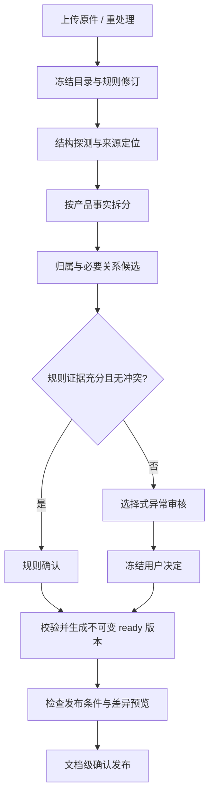

# V2 通用规则导入、选择式审核与事实级检索设计

日期：2026-10-26。状态：**待用户审核，尚未编码**。实现基线：`5276d06`；本文中的新增字段、状态、接口和规则均为建议契约。

本文集中维护本轮方案。当前实现仍以[SYSTEM_DESIGN](SYSTEM_DESIGN.md)、[API_GUIDE](API_GUIDE.md)及源码为准；进度在[TASK_BOARD](../TASK_BOARD.md)。批准实施后，将已落地内容整合回各主文档，不长期维护两套架构说明。

## 1. 目标、现状与范围

目标是让不同产品、不同常见格式的资料复用同一套处理流程：系统识别结构与事实归属，能确定的自动确认，有疑点的提出具体候选供用户选择；检索返回适用产品的原文事实及必要条件。

“自动确认”仅表示符合归属、结构与来源规则，不表示系统验证了原文事实在现实中为真。`evidence_status`继续保留`unassessed`，检索分数不作为正确概率。

| 当前证据 | 设计响应 |
| --- | --- |
| TXT仅按文件类型选择文本模式；Markdown式TXT和罗马数字标题可能丢失章节结构 | 内容结构探测、标题层级恢复、解析预览与可选择的纠正方式 |
| 审核页面主要按块列出unknown并要求配置映射 | 按问题组织候选卡片，展示“识别结果—依据—疑点—操作” |
| 当前发布是风险提示后确认，服务端并未要求逐块全部确认 | 明确新的服务端发布条件，避免UI与直接API行为不同 |
| Monkey语料的混合块将单品规格与礼盒事实一起绑定双产品，发生跨产品规格污染 | 先拆分可归属事实，再绑定；套件、比较、单品规格分别处理 |
| 当前已有产品实体、结构来源、审核映射、必要关系、重处理、版本发布与混合检索 | 复用现有PG、Worker、门户及V2检索链路 |

第一阶段包含CPU规则解析与审核、通用产品目录、事实级隔离、必要关系提示、选择式界面及检索验收。规则引擎不使用LLM，不要求GPU；现有检索所用Embedding及可选Reranker仍按现有配置运行，不能据此承诺整个检索系统没有模型依赖。

第一阶段支持中英文常见结构。复杂扫描件、错位表格、隐含指代以及未覆盖语种可进入人工处理；不能宣称任意文档全自动理解。后续CPU分类器或LLM只作为独立候选提供者，需另行评估，本轮不实现。

## 2. 通用性与配置分层

| 层次 | 内容 | 谁维护、何时维护 |
| --- | --- | --- |
| 通用引擎 | 标题树、列表/表格边界、型号匹配、原文定位、冲突检测、审核及发布 | 项目代码统一维护 |
| KB产品目录 | 稳定产品ID、名称、型号、别名、产品家族、可选套件实体 | 管理者首次批量导入或新增产品时确认，后续复用 |
| 可复用文档模板 | 规格表、产品手册、FAQ等结构模式；模板修订与适用条件 | 管理者选择已有模板；确有新结构时配置一次 |
| 领域属性字典 | 电压、重量、价格、保质期等属性及单位/同义词 | 按领域配置，未知属性仍保留原文，不阻止普通证据入库 |
| 单次文档决定 | 歧义产品选择、拆分方案、必要关系、排除内容 | 仅处理本次异常，冻结在本次处理快照 |

新增A300通常只需维护产品目录，不添加A300专属代码。新领域可以复用原文分块和审核流程；属性抽取覆盖度取决于领域字典，系统必须区分“未识别属性”与“文档没有该属性”。

实体名称不唯一时，候选展示“名称＋型号＋家族/品牌＋短ID”。所有引用限于当前KB。别名冲突不能靠匹配顺序决定；新增或修改目录不反向改写已发布事实，使用该目录的新处理任务冻结新修订。

## 3. 用户导入时实际需要做什么

| 场景 | 系统行为 | 用户操作 |
| --- | --- | --- |
| 已有产品、结构清楚的单产品文档 | 自动识别目录实体、章节与事实，提供汇总 | 上传、查看摘要、确认发布；不逐块填写 |
| 已有产品、结构清楚的多产品文档 | 按标题/表格/独立事实分别归属，分离套件内容 | 查看产品覆盖及抽样预览，无异常时文档级确认 |
| 明确单产品但原文结构不足 | 提出“全文默认归属产品X”的建议并显示例外 | 确认一次全文默认；检测到其他型号的内容仍单独处理 |
| 新产品或同名产品 | 从原文预填候选名称/型号，与目录匹配结果并列 | 选择已有产品或确认新建；仅缺失必要身份时填写 |
| 混合事实、引用重名、范围冲突 | 生成带原文和候选的异常卡片 | 接受建议、选择替代项、调整高亮范围或暂缓 |
| 通用品牌说明、术语、公共声明 | 提出“通用资料”候选并说明适用依据 | 按组确认；不被迫绑定某个产品 |
| OCR缺字、表格列对齐无法恢复 | 指出具体页/区域及受影响事实 | 选择可用解析方案、排除该范围或替换原件；无法凭空给出值 |

产品目录批量导入建议采用有界CSV模板，通过现有实体服务校验后写入；提供字段映射预览、重复/冲突清单和逐项结果。用户也可从上传文档的候选产品中选择新建，不要求先手工建立完整目录。

正常流程不要求用户填写JSON、产品UUID、来源单元ID、原文偏移、规则名或审核说明。审核人、时间、规则来源和常规理由由系统记录。自定义说明为可选项；不以强制填写理由代替有效验证。

## 4. 选择式审核界面

### 4.1 首页与卡片

顶部显示“自动确认、待确认问题、阻塞问题、已确认通用、已排除、可发布状态”。问题数与事实数分开：一个混合段落问题可能影响多个事实，不能把两者当成同一统计口径。

默认只展示待处理问题，支持按产品、章节、原因筛选；已自动确认内容可展开检查和撤回。每张卡片必须包含：

1. 原文与定位：页码/章节/表格行列或文本范围，高亮相关型号、值和条件。
2. 系统识别结果：候选产品、属性、原始值/单位、适用条件及拆分预览。
3. 需要确认的原因：例如“同一段存在两个型号，未找到明确对应关系”，不能只写unknown。
4. 推荐操作与替代操作：确认建议、改选产品、选择拆分方案、通用资料、不纳入检索、稍后处理。
5. 影响范围：本次影响哪些事实/章节、是否改变必要关系、是否解除发布阻塞。

候选建议不以“95%可信”等未经校准的数字呈现。显示“表格行型号精确匹配”“最近有效产品标题”“存在两种可能对应关系”等实际依据。预选推荐项只方便操作，点击确认才产生人工决定。

### 4.2 A100 / A200 / 套件示例

原文假设为：“A100额定电压12V；A200额定电压24V。套件K包含A100和A200。”

| 系统建议拆分 | 归属候选 | 用户看到的依据/操作 |
| --- | --- | --- |
| A100额定电压12V | A100 | 高亮“A100”“12V”；确认或改选目录产品 |
| A200额定电压24V | A200 | 高亮“A200”“24V”；确认或改选目录产品 |
| 套件K包含A100和A200 | 套件K；组件A100、A200 | 确认套件组成；目录无K时预填并提示新建或暂缓 |

在已验证的明确句法规则下，前两项可以自动确认，只在汇总中展示；若拆分规则未覆盖或身份存在歧义，整组作为一张待确认卡片，用户可“一次确认这三项”。

若原文只有“A100、A200：12V、24V”，系统不能仅按排列顺序直接确认。卡片应提供两个对应方案及“原文无法确定，暂缓/排除”，同时高亮原句。用户选择任何配对都记录为人工解释；没有可核验依据且用户也无法确认时，不发布为确定产品规格。

值来自原文，不让用户把12V直接修改成24V。原文有误应上传修订资料；选错抽取范围时允许点选另一个原文范围，再重新校验。原文与外部常识不一致时保留冲突，不伪造纠正后的引用。

套件为独立主体。组件关系不传递电压、价格、保质期等属性；查询A100电压不得把A200的24V或套件价格作为A100规格。原文只写“组合装”而没有稳定身份时先提出局部套件候选，确认身份后新建实体；未确认时保持未解决，不能退化成给整段贴两个产品标签。

### 4.3 必要关系与批量操作

关系卡片左右展示主事实和条件原文，如“保质期45天”→“未开封并按要求储存”；给出角色候选“条件/例外/适用范围/表头”。用户选择目标卡片和角色即可，系统记录来源。

批量确认仅作用于已明确列出的同类候选；显示数量和适用范围。支持当前页与跨页筛选结果，但跨页提交使用服务器冻结的集合标识与摘要，不能根据提交时变化的搜索结果扩大操作。拆分、排除、必要关系变化提供前后预览。

保留“查看全部、撤回本次选择、稍后继续”。草稿中撤回只追加反向决定；已经生成的版本不可变，要通过新草稿和重处理修改。候选都不正确时，用户可搜索目录或选择原文范围；仅新产品身份、真正缺失的模板信息需要输入。

## 5. 处理流程与确定性规则

首次处理生成可审核的ready结果及分析计划。用户集中保存选择后，一次重处理生成新的ready版本；不为每次点击启动解析或Embedding。最终版本仍有新问题时继续审核，不自动沿用过期候选。

### 5.1 结构恢复

- TXT内容探测结合标题标记、列表/表格语法、层级一致性；不能因单个`#`就判定整篇Markdown。支持用户选择“按检测结构/按纯文本”重新分析。
- Markdown识别ATX/Setext标题、围栏代码、列表及表格；代码块里的型号和标题样式不触发产品归属规则。
- 普通TXT识别数字、罗马数字、字母编号等常见标题，结合连续层级及相邻行约束。短型号、价格、年份不能仅因格式像标题就自动成为标题。
- DOCX/PDF复用Docling的结构输出；页眉页脚、跨页表格、合并单元格单独诊断。无法可靠恢复列对应时生成问题，不按视觉接近强行配对。
- 使用原文定位与结构ID记录边界；文本偏移注明基于解码文本的字符，不能混同字节偏移。PDF只保留实际可获得的页/区域定位，不虚构精确字符或单元格坐标。

### 5.2 先拆事实，再做归属

事实单元是“可独立确定主体及适用范围的一段原文证据”，不要求每句拆成主谓宾三元组。单一主体的连贯说明可以保持完整。

拆分边界来自明确的产品切换、列表项、表格产品列/行或已覆盖的句法模式；同一产品的条件、否定、例外、单位与限定词必须一并保留或建立必要关系。原始源单元保留，派生事实具有独立ID及来源范围列表。

表格先确定表头/产品轴。单行包含多产品多列时按产品列拆分，不能以“一行”作为安全归属的最小单位。每个值携带对应行名、列名和单位；多层表头无法唯一对应时暂缓自动确认。

同一父段落中拆出的事实不得自动互为可选近邻。检索输出正文使用事实范围；展示原文整段仅在有权限的审核/来源查看中提供，避免分块后仍通过上下文把无关产品规格带回结果。

比较句保留原文立场：例如“A100比A200轻”属于比较事实，不能伪造两个独立重量值。比较、套件组成、单品规格分别标记`fact_kind`，明确提及的实体可保存为`mentioned_entities`，但提及不等于属性归属。

### 5.3 归属判定

| 规则 | 自动确认条件 | 转人工的情况 |
| --- | --- | --- |
| 已确认精确绑定 | 原文范围及产品身份有效；与当前版本一致 | 范围变化、产品被替换、与明确原文冲突 |
| 表格主体 | 行/列产品唯一，表头及单位明确，无合并错位 | 多主体混排、表头缺失、重复型号 |
| 章节继承 | 有效产品标题命中审核目录；事实未切换主体 | 子标题/句内出现新主体、比较或套件内容 |
| 明确句内主体 | 目录精确命中＋经过验收的属性/谓词规则＋来源范围可核验 | 单纯提及、否定引用、指代、多个可能配对 |
| 文档默认 | 用户明确确认单产品范围，局部无冲突 | 检测到其他产品或通用资料，应分别处理 |

优先级用于选择具体来源范围，不用于吞掉矛盾。局部有效主体可结束父章节默认；多个同层明确证据冲突必须进入问题卡片。人工选择能解决歧义，但不能绕过不存在的原文、无效身份或范围校验。

精确匹配也需词边界、型号分隔与目录唯一性；A100不能匹配A1000。拼写相似仅用于候选排序，不能直接改写型号或自动确认。规则结果记录规则ID/修订、命中跨度及拒绝自动确认原因。

### 5.4 公共内容与必要关系

“已确认通用”是审核结论，不新增`applicability=common`：没有具体产品主体时仍保留`unknown`，另记`content_role=general`及确认来源。公共资料不能成为所有产品的事实。明确声明适用于A100和A200的同一条规则，可表达两者共同适用；这与把两条不同规格合在一起不同。

自动必要关系只来自可核验的表头、列表引导条件、明确引用、明确范围声明。独立出现“注意”或位置相邻仅生成候选，不能自动将整章都列为必要。

结构规则产生的关系使用独立来源类型（建议`structural_rule`）与规则、端点和原文证明，不能伪装成人工`curated`。人工选择使用真实审核记录作为来源。跨KB/文档版本、产品冲突、自引用、环及超限继续拒绝。

保持一跳、有界必要证据组；每个主事实最多20条直接关系。若条件还依赖另一条条件，需显式纳入主事实的直接组并保留证明；不能通过无限递归补齐。unknown条件仅在有效必要关系下加入，保持自身归属状态。

## 6. 数据设计、状态与一致性

下列为逻辑对象，落库时复用现有实体、版本、任务和结构字段；新增审核数据由PG维护。OpenSearch仅投影已经冻结的检索事实。

| 对象 | 关键字段与职责 |
| --- | --- |
| `ReviewPlan` | KB/document/source_version、原件hash、目录/解析/规则修订、计划修订、完成状态及问题统计；可编辑决定的容器 |
| `FactProposal` | plan内稳定ID、原始单元、来源范围、主体/属性/原始值候选、条件、fact_kind、证据来源；不是已发布事实 |
| `ReviewIssue` | 原因码、严重性、影响事实ID、有限候选方案、推荐项及理由、解决状态 |
| `ReviewDecision` | 问题/候选ID、动作、所选主体/范围、操作者、时间、计划修订、可选说明；追加记录，可追溯撤回 |
| `ReviewManifest` | 应用时冻结的计划/决定/规则摘要及版本绑定；供Worker重放、审计与发布校验 |
| 事实结构扩展 | 原始父单元＋事实范围；fact_kind、审核来源、已确认主体及必要关系；不把候选主体放入正式applicability |

每个候选值保留原始字符串；可选标准化值/单位另存，不覆盖原文。“30%减糖”不能标准化为“无糖”，“12–24V”不能丢掉范围符号。字段抽取失败时仍可保留完整原文事实。

三个状态轴独立：

- 归属：沿用`resolved / unknown / ambiguous`。
- 审核：`pending / rule_confirmed / human_confirmed / deferred / excluded`；通用是内容角色，不能用unknown直接推导“待审核”。
- 版本：沿用现有处理、ready、发布状态；新增发布资格计算，不把ready解释为已审核或已发布。

审核计划完成后默认无模型自动“学习”。确认某一文档不自动扩散成全KB规则；用户可以显式选择“保存为本模板规则”，经冲突预览后创建新模板修订，未来任务才能使用。

计划内候选持久化并分页，决定追加保存；最终manifest引用不可变记录及内容摘要，不靠可变外部对象重现结果。服务器生成来源ID、操作者和规则证明，客户端不能提交任意`approved`或伪造来源。

保存决定使用计划修订进行乐观并发控制；另一个用户已修改时返回409并提示差异。应用计划时冻结manifest、幂等创建重处理任务；Worker在来源hash、规则修订、租约和删除栅栏下应用。切换发布指针前再次检查目标版本、审核manifest及权限，不修改正在服务的旧版本。

修改拆分范围必须使依赖该范围的归属、属性及关系决定失效。重新解析只自动迁移能用原文hash＋结构位置＋范围证明唯一匹配的决定；无法一一对应时呈现“需要重新确认”，不能沿用旧块ID。

## 7. V2 API 与发布条件

### 7.1 建议接口

所有写操作沿用KB write权限；查询最终证据继续沿用现有读权限及PG复验。产品目录管理沿用现有实体权限，不新增隐含权限等级。

| 接口建议 | 行为 |
| --- | --- |
| `POST /v2/documents/{d}/versions/{v}/review-plans` | 幂等创建分析任务，202返回任务/plan标识；同版本同配置复用结果 |
| `GET /v2/review-plans/{p}` | 返回摘要、处理进度、修订、发布阻塞原因 |
| `GET /v2/review-plans/{p}/issues` | 按原因/产品/章节分页返回问题与有限候选 |
| `GET /v2/review-plans/{p}/facts` | 分页查看包括已自动确认在内的事实预览 |
| `POST /v2/review-plans/{p}/decisions` | 有界批量提交选择，校验计划修订与候选身份；保存草稿不改已发布内容 |
| `POST /v2/review-plans/{p}/apply` | 冻结manifest并复用重处理任务，202返回新版本/任务；重试幂等 |
| 现有review接口扩展 | 增加计划入口、按事实的审核摘要及发布资格，不把拟议字段当作现有契约 |
| 现有publish接口收紧 | 服务端复核审核资格；失败409返回具体问题计数及审核入口 |

默认一次批量决定要么全部成功，要么全部失败，避免用户误以为确认了整组。校验失败返回具体问题ID和原因。跨页集合先由服务器冻结为可审计的集合，再分批执行并展示进度；部分完成不得显示为全部确认。

### 7.2 建议发布策略

| 内容状态 | 能否发布进入检索 | 处理办法 |
| --- | --- | --- |
| 规则确认或人工确认，原文/主体/依赖有效 | 可以 | 默认仍需一次文档级发布确认 |
| 已人工/规则确认的通用资料，产品归属unknown | 可以 | 保留通用角色及unknown，不通过产品过滤冒充产品规格 |
| 产品歧义、未确认混合拆分、必要依赖缺失、来源损坏 | 不可以 | 解决问题，或明确排除相关事实组 |
| 暂缓的产品事实 | 不可以直接进入检索 | 保留草稿；用户可选择排除本次发布 |
| 已排除事实 | 不进入检索 | 保留原件和审核记录；显示被排除范围及数量 |

排除内容只影响新派生版本的检索事实，不删原件。若被排除内容是其他事实的必要条件，那些主事实也必须解决或一并排除，不能静默发布不完整事实。至少有一个可检索事实才允许发布；不能用全排除掩盖解析失败。

`auto_publish=true`保留“满足条件后自动发布”的含义，但不再绕过上述服务端条件；有阻塞时任务处理成功、版本保持ready，并返回审核待办，而不是把整个任务标成解析失败。默认关闭。该变化属于需要发布说明和消费端同步的行为收紧。

初期不提供“忽略全部阻塞强行发布”。这是一项待审核的新策略，比当前确认警告后发布更严格；目的在于避免明确已知的跨产品污染。需要部分发布时采用显式排除，而非让歧义事实继续进入结果。

## 8. 检索准确性设计

| 环节 | 本轮变化 | 准确性作用 |
| --- | --- | --- |
| 入库 | 按事实独立归属，单品/比较/套件分离 | 防止整段标签正确但内部属性属于另一产品 |
| 索引 | 投影冻结主体、型号、章节、属性词及事实类型，原文不改写 | 提高产品＋属性查询匹配，保留可核验出处 |
| 查询归一化 | 只用已审核唯一别名归一化；精确型号不做模糊替换 | 防止A100与A1000、A200误合并 |
| 候选检索 | 保持现有关键词/向量/RRF与可选重排 | 利用结构改善候选，不承诺更换模型即解决归属 |
| 产品过滤 | 根据正式主体判断，最终PG复验 | 提及、组件关系、查询里的产品名不授予主体身份 |
| 证据组装 | 保留必要限定与原文差异；可选近邻重新校验事实主体 | 防止正确主块附带另一产品的价格、电压或期限 |
| 输出 | 明确fact_kind、主体与来源；未知充分性仍unassessed | 消费方可区分单品规格、套件组成与比较陈述 |

套件组成默认仅归套件主体；按组件过滤的普通检索不自动带出套件事实。用户问“包含A100的套件”时，可用现有显式关系能力定位套件，再检索套件主体；第一阶段不新增自动多跳查询规划。

比较事实明确以多个产品为主体时可命中相应过滤，但保留比较原文和类型；不能将其中A200的数值抽成A100属性。属性查询通过字段/类型排序优先取直接规格，并在验收中统计不相关比较结果，不能只依靠标签一致性判定成功。

查询只有“电压多少”且没有产品条件时，不猜产品。返回的各事实仍分别有主体，调用方可据此澄清。唯一型号无法匹配时不模糊替换成近似型号；普通词语里看似型号的字符串也不能未经识别就强制过滤。

无答案检索须单独验收。沿用已有人工相关性校准机制，校准集和测试集分离；未校准或配置失配保持明确状态，不把“返回了候选”说成“存在答案”。检索排名分数、审核状态和证据充分性三者互不替代。

现有六项优化继续保留：[同实体兼容合并、搜索部分失败识别、相关性校准、整组预算、差异保护、可信投影/关系排序](SYSTEM_DESIGN.md#7-六项准确性优化与验证边界)。本轮重点补充事实粒度、上下文隔离和审核输入，不重复另建检索架构。

## 9. CPU实现选择与运行边界

| 能力 | 首选实现 | 边界 |
| --- | --- | --- |
| 标题、列表与规则匹配 | Python正则＋有限状态机；评估markdown-it-py生成结构token | 必须保留原始跨度，避免灾难性正则回溯 |
| 产品目录精确匹配 | 当前有界目录用规范化词典/边界匹配；规模需要时评估pyahocorasick | 唯一命中不自动证明句内事实归属 |
| 相近名称候选 | 按需使用RapidFuzz，CPU执行 | 仅供人工选择，不自动确认型号 |
| PDF/DOCX | 复用Docling，配置CPU解析/OCR路径 | 在实际CPU硬件上测内存和耗时，复杂扫描件可能较慢 |
| 模板/属性与单位 | 版本化配置及确定性规则 | 不执行用户提供的Python或任意正则代码 |

只增加确有收益且能维护跨度的依赖，锁定版本并核对许可证；不同时引入多个功能重叠的NLP框架。规则审查不需要新GPU服务、Redis、独立向量库或图数据库。

建议初始限制（待实现验证，不是性能承诺）：每页25/最多100项，每问题最多5个展示候选、目录搜索另分页；每批最多100个决定，每事实最多20条必要关系，每文档最多10000个事实提案及10000个问题。候选生成先按章节/产品建立索引，避免全事实两两比较。

保持现有目录快照最多1000实体/每实体100别名、现有处理快照512000字节限制。超限明确报告，不静默遗漏。大量自动归属通过规则结果和独立审核记录承载，不把每个事实都转成客户端`scope_bindings`而撞到其100条上限；最终manifest按不可变记录引用并校验摘要。

分析复用PG任务及Worker租约、幂等和有界重试；结构分析、候选生成采用可恢复阶段和明确的阶段超时。确定性解析/规则冲突不重试，临时资源故障有界退避。超时或达到容量上限时计划标记不完整并阻止应用，不能把截断结果当作全篇确认。具体时间/内存阈值依据基准测量落入配置。

审核接口和原文预览复用KB权限，撤权后拒绝继续读取/保存；正文在网页中转义，限制预览大小，默认日志不记录私有原文或Key。审核记录的执行者使用现有认证主体/Key标识，不能声称已有独立人类账号体系。

## 10. 验收计划

### 10.1 语料与对照

保留Monkey真实语料的业务失败作为必修回归；以真实事实内容判断污染，不依赖固定“第47号单元”或旧chunk ID。新增至少三个不同产品家族，覆盖规格、价格、适用条件、版本、FAQ、公共说明、比较和套件；含目录已知及新型号。

TXT、Markdown、DOCX、文本PDF分别验证；扫描PDF作为单独OCR组，不把从TXT转换的简单PDF验收当作任意真实PDF通过。同一内容跨格式检查主体/值/限定一致，允许解析块ID和数量不同。

人工标注主体、原文事实范围、必要限定、可接受关系及各查询的相关/不相关证据。开发模板与最终验收文档按文档和产品家族隔离，防止只适配月饼或A100示例。模型、配置、语料hash、发布版本和查询固定后再对比。

### 10.2 必须覆盖的案例

| 类别 | 必须验证 |
| --- | --- |
| 事实隔离 | A100=12V、A200=24V及独立套件；月饼单品规格与混合礼盒；多产品同句、同列表、同行多列 |
| 误识别 | A100/A1000、重复别名、型号缺失、代码块、年份被当标题、否定/引用中的产品提及 |
| 条件保留 | 未开封期限与开封期限、范围单位、减糖与无糖、例外、列表引导条件、跨页表头 |
| 归属边界 | 单产品默认遇到局部其他产品、公共内容保持unknown、比较/套件属性不向组件传递 |
| 交互 | 系统预填候选，用户不输入JSON/ID即可完成常见案例；候选全错、撤回、批量预览、草稿恢复 |
| 一致性 | 并发409、重复提交幂等、重解析使旧选择失效、目录修订、发布与撤权竞态、旧版本持续服务 |
| 发布 | UI/API/auto_publish相同门槛；排除必要条件时主事实不能残缺发布；全排除拒绝 |
| 检索路径 | exact、hybrid、adaptive、可选重排、真实BM25故障降级；主证据和所有context_parts均检查污染 |
| 无答案 | 不存在型号、缺失属性、没有依据的认证、中文问英文资料；真实模型独立验证 |
| 故障/负载 | CPU解析、超限、超时、Worker重启、索引失败、重处理失败不影响当前发布内容 |

### 10.3 指标与建议验收门槛

| 指标 | 定义 | 建议门槛 |
| --- | --- | --- |
| 自动归属精度 | 自动确认且人工金标正确的主体/事实对应数÷自动确认数 | 隔离验收集≥99%；同时报告样本数与置信区间，样本不足不宣称达到生产概率 |
| 关键跨产品污染 | 产品过滤结果及附带上下文中被错误当成目标产品属性的事实 | 上述必测危险案例为0；任一复现即阻断交付 |
| 必要条件完整率 | 返回主事实时所需限定全部存在的比例 | 必测限定案例100%，预算不足则省略整组并明确诊断 |
| 检索相关性 | 人工相关性标签的Precision@k、Recall@k、nDCG@k，固定同查询比较 | 分产品/格式/路径报告；准确率不下降，新增噪声不得用召回提升掩盖 |
| 自动确认覆盖率 | 规则确认的可审核事实数÷全部可审核事实数 | 报告实测，不预先承诺比例，不以强行resolved提高数值 |
| 人工负担 | 每文档决策次数、耗时、必须自由填写的字段数 | 标准已知产品案例自由填写为0；对比现流程下降，异常单列 |
| 可追溯性 | 已确认事实/必要关系能回溯原文及规则或人工决定的比例 | 必测案例100% |

业务事实正确性与块标签一致性分别判定。规则自动确认达到高精度也不说明原文真实；检索Recall高也不代表返回内容没有污染。真实模型、跨语言与目标CPU/并发性能另报告，不用hash向量或词法测试重排替代生产结论。

## 11. 实施顺序、发布与回退

用户审核本方案后按以下顺序实施，阶段结果写入任务板；本轮不执行这些编码或测试步骤。

| 阶段 | 交付 | 进入下一阶段条件 |
| --- | --- | --- |
| A 结构与事实隔离 | TXT/Markdown结构恢复、列表/表格事实拆分、来源定位、套件/比较边界 | Monkey污染及A100/A200回归通过，条件不丢失 |
| B 规则与审核数据 | 目录复用、归属/依赖规则、计划/候选/决定/manifest、重处理一致性 | 确定性、原文校验、并发及幂等验证通过 |
| C 选择式门户与发布 | 候选卡片、组确认、排除/撤回、服务端发布资格、V2契约 | 常见案例无需手填，UI/API权限与发布行为一致 |
| D 检索与业务验收 | 事实投影、上下文隔离、多家族多格式/真实路径验收、文档整合 | 业务门槛通过，记录未验证生产项，再完成授权的代码交付 |

解析与事实结构升级需要重处理原件并审核发布；仅generation不能修复已存PG的错误归属。投影字段变化需生成新index并验证后切换，不能直接修改旧索引meta标记绕过校验。

涉及产品代码的交付需要重建API/Worker镜像；本轮设计文档本身不要求重建容器。部署检查应验证index兼容与可用性，并对`INDEX_UPGRADE_REQUIRED`提供明确操作入口；已报告的ready未捕获500作为关联问题单独跟踪，不能宣称本方案已修复它。

按项目现行约定，数据库结构只修改完整`db/schema.sql`，不在此方案中承诺原有生产库原地升级。已有部署应保留原库/原件/备份，在独立新环境初始化并重新导入、重处理和验收后切换；产品目录、权限和历史数据的迁移/导出方式需在实际部署计划中核实，不能靠删除生产卷实现。设计批准不等于授权操作生产数据。

失败回退保留原发布版本；新版本未通过验收不切换发布指针。应用/数据库格式已变化时优先切回保留的原环境，不把旧应用直接连到未经验证的新schema。旧数据的restore也须生成新版本并重新检查发布条件，不自动绕过新审核规则。

## 12. 本次审核重点

建议批准的整体方案是：**CPU规则优先，结构与事实隔离先行；系统给出候选和依据，用户选择确认；文档级发布，异常集中处理。**

尤其需审核以下产品行为，它们将决定后续编码：

1. 常规内容自动确认，默认只需文档级发布；候选缺失时才要求必要填写。
2. 套件独立归属，组件属性不互相继承；比较事实保留比较角色。
3. 已确认通用资料允许保留unknown；产品歧义、损坏来源、缺失必要条件须处理或明确排除后发布。
4. 采用服务端统一发布门槛，`auto_publish`也不能绕过，替代当前仅警告后继续发布的行为。
5. 第一阶段不接LLM/分类模型；自动确认比例、检索收益和CPU吞吐以独立验收结果为准。
