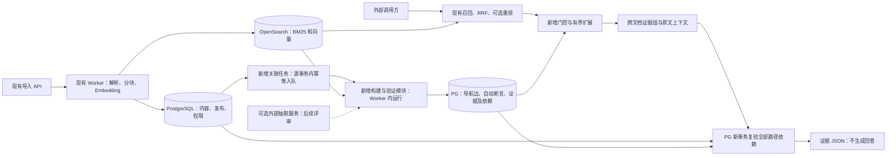
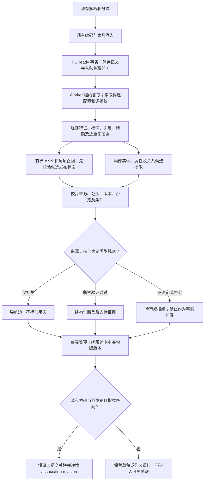
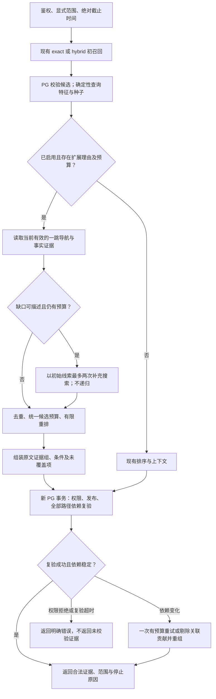
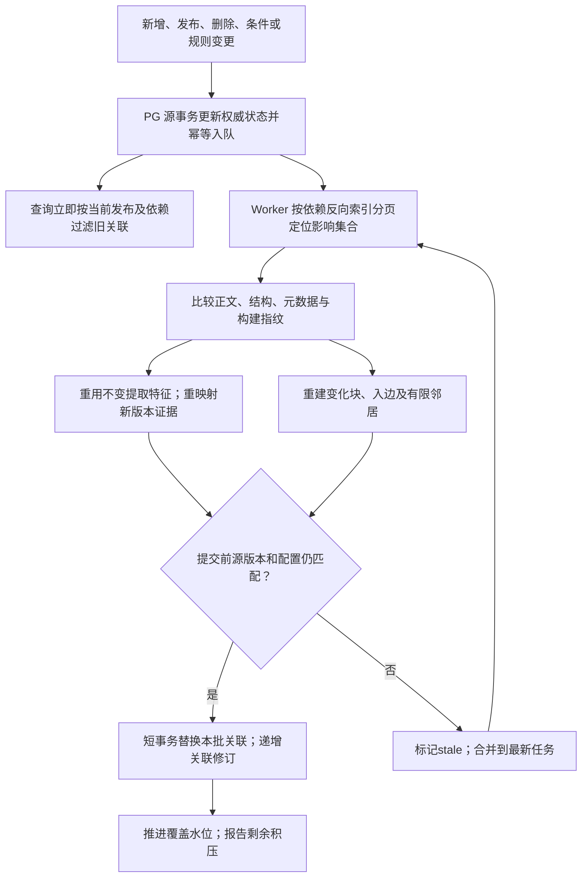

# CueKB 自动知识关联与动态联想：架构评审稿

> 2026-10-23合并说明：本文件保留2026-10-08独立离线关联研究设计；第2节等“当前源码”指下述旧基线，不代表现行V2实现。现行接口、deadline、处理快照和验收状态以API_GUIDE、SYSTEM_DESIGN、SYSTEM_CONSTRAINTS及TASK_BOARD为准。M4编号为旧规划代号，不是当前未完成事项的清单；线上接入仍未实现，研究中的新表/字段/LLM例外均未启用。
日期：2026-10-08。状态：**用户已授权先实施最小离线实验和示例；其余阶段按本稿门槛推进，未做真实关联质量或生产性能验收**。实现入口见[离线实验说明](../../experiments/associations/README.md)，实际进度见任务板；本稿其余新表、线上接口与LLM等设计不因离线实现而自动成为现行契约。

源码基线：`0ab322ffa26351d218712a845726e61decae179c`。本稿以实际代码为依据；当前实现见[系统设计](../SYSTEM_DESIGN.md)，已接受决策见[DECISIONS](../../DECISIONS.md)，执行状态只记入[任务板](../../TASK_BOARD.md)。文中的新表、接口、参数、路径均为建议，不是当前契约。

## 1. 推荐结论与评审范围

推荐 **C-lite：语义与文本结构发现候选，少量确定性规则验证结构化事实，查询按需做一次有界扩展**。使用现有PostgreSQL、OpenSearch和独立Worker，不引入图数据库或Agent Runtime。关联模块默认关闭；最初在独立离线实验入口运行，不改线上检索行为。

核心判断：

1. **无需先构建完整实体关系图谱。** 块级语义邻居、明确引用、相同标识符、章节结构即可提供可检索的“导航关联”。它们表示值得查阅，不表示支持、兼容或因果。
2. **自动关联分两层。** 导入后自动生成有数量上限的导航边；仅将主体、谓词、对象/属性、否定和条件均有原文支持的提取结果列为“经验证的结构化断言”。验证的是与来源一致，不是真实世界真值。
3. **查询先复用现有召回。** 简单问题保持原路径；明确跨文档问题或有限任务模板存在证据缺口时，激活已保存的一跳关系。必要时以初始线索发起至多两次补充搜索，不在线重建全库网络、不强制调用LLM。
4. **安全失效同步，补建异步。** 所有路径节点、边和支持证据都必须仍属当前发布版本、合法KB和适用条件；后台延迟只能影响召回，不能使失效证据重新出现。
5. **是否优于基线由冻结实验决定。** 同语料比较H、H+A、H+B、H+C；若混合方案收益不足，交付最简单的达标方案，或保持现有H。

推荐最小实验的范围：约30份英文文档；同KB内跨文档；一跳；无查询LLM；无需后台LLM；8条导航边/块、4个查询种子、最多24条新增候选；事实谓词仅选择语料中能用规则可靠验证的2—3类。两跳、跨KB持久边、广泛自然语言关系抽取和线上“证据充分”判断均不在首轮。

### 1.1 事实、目标、假设的标记

| 标记 | 本稿用途 |
| --- | --- |
| 当前实现 | 已阅读源码支持的行为，不等于生产验收 |
| 提议设计 | 待评审的数据结构、流程及接口 |
| 实验起始参数 | 可在开发集调整，冻结测试前锁定，不是生产SLA |
| 待验证假设 | 尚无本项目实测结果支持的收益判断 |

本轮完成源码分析与文档检查；没有采集30份语料、调用模型、构建关联或测量性能。此前开发环境的普通单元测试不构成本方案的关联实验结果。

### 1.2 与已接受决策的关系

| 决策 | 本提案处理 | 评审项目与替代方案 |
| --- | --- | --- |
| D02/D19：只提供检索证据 | 保持；不新增回答API或门户问答 | 可选后台LLM抽取需要对D19“不提供生成式模型配置”增加明确例外；限Worker提取用途。首轮规则方案不需要该例外 |
| D03/D07：PG、OpenSearch、独立Worker | 保持 | 增加PG派生任务，复用租约/幂等模式；不是现有outbox可直接多订阅 |
| D06/D17：管理员关系、一跳 | 一跳保持；自动候选及机器验证来源属于新增来源政策 | 须批准自动关系状态、谓词白名单及独立读通路；替代为只保存导航候选，事实仍人工审核。两跳另行评审，不默认为本提案批准 |
| D08：KB级ACL | 保持 | 首轮不持久化跨KB边；多KB请求各KB独立扩展后合并 |
| D15/D18：外部模型、generation | 保持模型/索引一致性和PG指针裁决 | 新增独立关联构建版本，不冒用向量generation；切换后不匹配的语义边停用 |
| D20：venv/pip | 保持 | 首轮算法可用标准库及已有依赖；可选NLP库须在后续任务说明收益再评审 |

本稿不修改DECISIONS中的accepted记录。需要批准的是实验范围和新行为；性能门槛也是待评审目标，不能把评审前的提案当作实施授权。

## 2. 当前源码能力与差距

### 2.1 能力核对与定位

以下链接相对本稿；函数名用于在后续代码变化时定位，不依赖易漂移的行号。

| 当前能力及实际边界 | 源码依据 | 本方案处理 |
| --- | --- | --- |
| `auto`只按标识符正则选exact/hybrid；exact跳过Embedding及重排；related由调用方显式选择 | [retrieval.py](../../src/cuekb/services/retrieval.py)：`QueryRouter.route` | 复用路由基线；新增独立、保守的扩展门控，不把问题长度当复杂度 |
| BM25与查询向量并行；RRF常数60；重排默认头部30；关键词/向量默认各50 | [retrieval.py](../../src/cuekb/services/retrieval.py)：`_search_evidence`；[config.py](../../src/cuekb/config.py) | 复用候选和排序；同一证据不因多条关联重复加票 |
| 一跳从显式实体、完整query名称/别名匹配、初召回块mention取最多20实体；seed块最多100；默认30条关系证据、100ms SQL预算 | [knowledge.py](../../src/cuekb/adapters/knowledge.py)：`related_chunks` | 新门控需按查询相关性选种子；当前SQL按关系/块ID排序，不是关联强度排序 |
| 关系返回的是`relation_evidence`引用块，不是自动获取目标实体所有文档；实体、别名、mention、关系由管理API写入 | [knowledge.py](../../src/cuekb/adapters/knowledge.py)：`put_entity`、`put_relation`、`related_chunks` | 新增自动提取、归一化、验证与目标证据候选；避免误称当前已有自动知识发现 |
| 事实类型只有belongs_to、adjacent_to、alias_of、revises、replaces、references、depends_on、applies_to；条件仅型号/软件版本精确字符串 | [schemas.py](../../src/cuekb/schemas.py)：`RelationType`、`RelationWrite`；[初始化schema](../../db/schema.sql) | supports/compatible_with/属性值等不能直接写入旧表；设计新的自动候选表和明确谓词契约 |
| `supports/refutes`是证据对断言的立场；没有自动置信、审核状态、抽取方法、版本化pipeline | 同上；`relation_evidence` | 与事实谓词`supports_capability`明确区分；新增来源和状态 |
| 单次读取用REPEATABLE READ；完成后新事务复验Key、ACL、内容修订、发布、关系与上下文；最多一次重试 | [retrieval.py](../../src/cuekb/services/retrieval.py)：`search_evidence`；[knowledge.py](../../src/cuekb/adapters/knowledge.py)：`read_snapshot` | 复用语义，增加关联修订和整条路径依赖复验；不能只校验终点块 |
| 上下文按同文档同版本的章节/邻近块组织，默认8块/命中、4000字符/命中、12000字符/响应 | [context.py](../../src/cuekb/services/context.py)；`knowledge.context_chunks` | 保持原文上下文，跨文档证据组作为新元数据，不拼成生成结论 |
| Worker整文件解析；块ID为UUID5(version_id, ordinal)；32条一批Embedding；索引refresh后PG保存ready，可自动发布 | [worker.py](../../src/cuekb/worker.py)：`_run_ingestion_once`；[postgres.py](../../src/cuekb/adapters/postgres.py)：`save_ready` | 新版本不会保留旧块ID；增量复用需内容/结构/元数据指纹，不能靠ordinal映射 |
| 发布和删除同事务写outbox；outbox只有一个processed_at，由Worker领取并完成，当前只处理两类事件 | [postgres.py](../../src/cuekb/adapters/postgres.py)：`_publish_locked`、`delete_document`、`claim_outbox`；[worker.py](../../src/cuekb/worker.py)：`_process_outbox` | 不增加会抢走旧事件的独立消费者；在源事务追加关联任务或原处理器幂等派发 |
| PG载入块才判当前发布和删除；OpenSearch只作候选；原索引可能含ready或过期块 | [postgres.py](../../src/cuekb/adapters/postgres.py)：`load_chunks`；[opensearch.py](../../src/cuekb/adapters/opensearch.py) | 关联候选也先经PG过滤；草稿不能通过可见文档上的派生边泄漏 |
| OpenSearch采用Lucene HNSW/cosinesimil；写入保留embedding；检索适配器只返回ID/score | [opensearch.py](../../src/cuekb/adapters/opensearch.py)：`ensure_index`、`index`、`_hits` | 可复用现有向量，但需新增Worker专用批量读向量能力；当前没有该接口 |
| generation维护锁、源修订校验、PG内模型/物理索引切换；回退是用旧模型重建当前内容 | [generations.py](../../src/cuekb/adapters/generations.py)；[重建服务](../../src/cuekb/services/generations.py) | 复用模式，关联构建生命周期独立；不复制旧关系掩盖新权限/内容 |
| 当前deadline是阶段预算；同步Future等待、退出等待、最终PG复验及重试未共享硬截止；evidence_status固定unassessed | [retrieval.py](../../src/cuekb/services/retrieval.py)；[现行预算与取消边界](../SYSTEM_CONSTRAINTS.md) | 不能声称当前可取消或能判断充分；实验与M4协同见§12 |

现有[关系测试](../../tests/test_m3.py)、[PG关系测试](../../tests/test_m3_postgres.py)提供权限撤回、版本切换、时间条件、SQL超时等测试入口；本轮只阅读，未重跑。开发内存模式不具备真实PG/搜索/关系行为，不能作为新架构验收环境。

### 2.2 实际缺口

缺少：自动抽取和实体消歧；跨文档导航邻居；机器关系的来源/状态/条件模型；基于证据缺口的门控；跨文档证据组；变化依赖反查及任务；关联构建版本；真正总预算；冻结的关联评测集。它们是独立问题，不能仅增加一张“图”表就一起解决。

## 3. 三条路线与抽取技术比较

### 3.1 路线比较

以下是结合现有代码的工程推断，不是实测排名。

| 维度 | A：轻量语义关联 | B：结构化知识网络 | C：语义＋结构化 |
| --- | --- | --- | --- |
| 准确性、跨文档完整性 | 易找到同主题和改写；无法区分兼容、否定、依赖与相似 | 精确标识、条件和可靠谓词时可定向取证；漏抽取或别名错误导致缺失 | 语义补召回、结构化限定条件；预期更均衡，但错误仍可能叠加 |
| 入库计算 | 已有向量基础上每新块少量ANN/词项查询和局部打分 | 每块实体/属性/关系提取、归一化与验证；LLM方案成本最高 | 两者叠加；通过规则白名单及限制提取窗口缩小成本 |
| 查询延迟 | 邻接表读取快；动态搜索与重排增加I/O | PG索引邻接读取适合一跳；复杂条件和热门节点易放大 | 合并候选后共用一次重排；若无统一预算容易双倍开销 |
| 噪声风险 | 近似型号、同主题、重复模板、否定句很危险 | 错误实体合并、关系方向/条件丢失、幻觉 | 严格区分导航和事实后可控，不能用一层分数替另一层证明 |
| 增量复杂度 | 更新节点邻居和反向依赖；近似top-k维护有漏检 | 重算受影响mention、断言、支持证据及别名；粒度更细 | 多类依赖需统一版本/失效协议，复杂度高于A |
| 存储 | O(Nd)边，不复制原向量；邻接索引 | O(M+F+P)：mention、事实、证据；依赖扇出可能很大 | 两者总和；需分类型配额和容量拒绝策略 |
| 外部模型 | 复用Embedding；可选Reranker | 规则可零新增模型；NLP/LLM取决于语料 | 首轮零新增模型，后来按误差类型评估LLM |
| 代码复用 | OpenSearch、块、PG校验、Worker | 现有实体/关系/权限/时间/证据结构高复用，状态和谓词需扩展 | 复用最多，但新增编排与生命周期不能忽略 |
| 实施维护 | 最低；语义门槛随模型变化需重校准 | 规则/本体/消歧维护较重；通用抽取难 | C-lite中等，完整版最高；应按对照收益递进 |

A算法：对每个新块的既有向量检索有限邻居，加入关键词、明确引用和结构候选；去除同文档重复、版本冲突及不适用范围，保存少量导航边。HNSW只提供近似邻居，不保证全局最优或严格对数复杂度。不能在大库全量两两计算。

B算法：识别实体及字面属性→保守归一化→提取带方向、否定、条件的断言→定位证据→有限类型规则验证→PG邻接查询。有限一跳的关系量和现有事务需求均适合PG复合索引；没有证据表明本任务需要Neo4j。仅在未来测出PG对必要图查询不能达标时，才评估新基础设施和双写一致性成本。

C-lite首轮将A的导航边与B的少量可靠谓词并行提供候选，并在统一预算和校验下融合。推荐它是因为能按消融结果独立停用A或B，**不是已经证明它胜出**。

不以纯A作为最终默认：无法表达“相似但不兼容”；仍保留为最低成本候选。不以完整B作为起点：实体/本体覆盖和抽取验证成本较大，30份文档不足以支持通用图谱投资。不采用完整版C：LLM、多跳、跨KB和通用推理同时引入会让收益归因及失效处理失控。

### 3.2 提取技术的取舍

| 方法 | 用途与首轮选择 | 局限与升级条件 |
| --- | --- | --- |
| 规则、正则、词典、表格列约束 | 首轮采用：型号、协议名、明确引用、单位数值、版本、否定及简单支持/依赖句型 | 高精度低召回；词典只定义领域类别和标识规范，不包含测试gold关系 |
| 传统NLP：分词、词性、依存句法、统计NER | 可选对照：解决句型变化、名词短语、指代范围 | 英文域外和长句仍会错；仅在标注误差显示规则召回受限且收益超过依赖成本时引入 |
| 轻量NER/关系分类/NLI模型 | 可选外部服务：实体候选、局部支持/矛盾评分 | 需领域校准；模型标签/分数不等于事实，不能替代型号、版本和证据检查 |
| LLM结构化抽取 | 后期可选后台：复杂表格说明、条件/否定表达 | 成本、输出稳定性、幻觉、提示注入；必须严格JSON、引用校验、配额和审核；普通查询无依赖 |

否定、数值、型号后缀和条件在规范化时保留。`Bulb A1`和`Bulb A1 Pro`不靠向量近似合并；大小写/空白规范化也需产品命名规则支持。别名优先采用原文明确“also known as”、精确标识或已有审核别名；模糊匹配只进入待审候选。

## 4. 总体架构与模块责任

“记忆巩固”对应后台构建，“线索激活”对应有界候选扩展，“遗忘/修订”对应依赖失效。它们只是工程类比，不是神经网络模拟，也不构成算法有效性的证据。



### 4.1 复用、新增和修改清单

所有修改仅为未来实现规划。

| 模块 | 类型 | 责任、建议位置与边界 |
| --- | --- | --- |
| 解析、结构块、原件、Embedding、主索引 | 复用 | `services/parsing.py`、`worker.py`、`adapters/storage.py`；首轮不改变分块算法 |
| 候选发现器 | 新增 | 建议`services/associations/discovery.py`；ANN、BM25、引用、标识匹配；只输出候选 |
| 事实提取/验证器 | 新增 | `services/associations/extraction.py`、`validation.py`；可替换规则/外部模型；输出断言及证据，不写发布指针 |
| 关联仓储与调度 | 新增＋局部修改 | `adapters/associations.py`；源事务入队、依赖反查、租约、CAS提交；Worker增加低优先级工作类型 |
| 查询门控和扩展器 | 新增 | `services/associations/query.py`；门控、种子、一个扩展前沿、动态发现、配额和停止原因 |
| 证据分组器 | 新增，复用上下文 | `services/associations/evidence.py`；原文证据组、缺口、冲突候选；不替代`assemble_context` |
| 检索与依赖装配 | 后期局部修改 | 在初召回后、最终排序前接入Provider；`off`不读新表、不调用新模型；不重写主流程 |
| PG快照和最终校验 | 复用＋必须扩展 | 批量复验起点、终点、证据、条件、构建状态和关联revision |
| OpenSearch适配器 | 局部修改 | Worker批量读既有向量/有界候选；查询补充调用有预算；不新建向量库 |
| 实验入口 | 新增且先行 | 建议`experiments/associations/`，只在后续任务创建；冻结manifest、对照运行器、指标及原始结果 |

## 5. 入库自动关联流程



### 5.1 候选发现与数量约束

1. 从PG权威块抽取特征：标题路径、精确型号、协议/功能词、原文引用、数值单位、显式否定、适用版本。关键词提取首先用规则/词频，不让LLM生成未出现的型号。
2. 向量来源优先复用当前索引中同一`search_text`编码；可在入库批次中传递向量，任务重启后通过Worker受控批量接口读取。不得假设现有ID/score接口已经返回向量。缺失向量时按原模型和完全相同编码配置重新编码该批次，计入成本；配置不匹配则暂停语义构建。
3. 每新块最多ANN 20个＋BM25/引用20个候选，去重后最多40个。去除自身、限制同文档边；通过PG检查目标证据已发布。draft只可作为当前构建源，不能进入其他已发布文档的可见邻居。
4. 精确重复用正文哈希，近重复用保留数字/否定/型号的token shingles Jaccard作候选检测；表头、单位及条件不同不能合并。近重复只标`near_duplicate`，不覆盖原文。
5. 每块导航出边最多8条，其中语义边最多4条；每个目标文档最多2条，优先跨文档、明确引用及不同证据用途。同文档章节邻接直接复用现有上下文，不大量物化边。
6. 给候选保存选择依据和排除原因。禁止按访问次数自动把边升级为事实。没有可靠边时允许零边，不为了达到配额强行补足。

持久化：常用且可复查的导航邻居、明确引用、经验证断言、候选状态、证据与依赖、算法配置和水位。临时计算：查询相关性、当前授权范围、查询门控、证据缺口、动态搜索候选、排序路径；首轮查询临时边不回写。这样避免单次查询意图污染全库关系。

### 5.2 抽取与验证

结构化断言必须携带：主体、谓词、对象或有类型的属性值、极性、条件、有效时间及最小支持原文集合。允许一个断言有多个替代支持集合；集合内部为AND，集合之间为OR，不能把缺一条前提的多证据断言视作完整。

验证依次执行：schema/大小检查→同KB及来源ID检查→逐段原文offset/quote/hash对齐→实体消歧→方向/类型白名单→否定、数值单位、型号和条件核对→所需证据集合完整性→冲突检查→状态决定。模型声称的quote不存在或参数不匹配即拒绝，不自动修补成模型猜测。

首轮规则仅接受明确句型/表格行，如“X requires Y”“X supports protocol P”“X is compatible with Y only with firmware F”。不能从“X与Y都使用Z”推断X兼容Y，也不能从两个`depends_on`自动推出传递事实。反驳证据保留为`stance=refutes`；存在反驳不等于系统替用户判定谁正确。

冲突候选只在同一已归一主体、同一属性/谓词、重叠条件和有效区间内比较。功能值差异、极性冲突或互斥值才可能冲突；不同地区、固件或文档时期先区分适用范围。无法判断范围交集时标`unresolved`，不自动裁决。两个厂商原文互相矛盾时，两条来源均可检索，附冲突候选标签。

## 6. 关联数据模型与存储结构

### 6.1 五类版本及两个独立修订

| 概念 | 标识及用途 | 不能混用 |
| --- | --- | --- |
| 文档存储版本 | `document_versions.id`；一次导入产生的正文/块版本 | 不等于已发布或软件版本 |
| 文档发布版本 | `document_publications.active_version_id`，唯一default | 存储ready不自动可检索；关系时间at不允许检索历史发布正文 |
| 业务版本 | 产品型号、firmware/software_version、business_version原始字符串及受控解析值 | 文档修订日期不代表固件版本；未知格式不进行大小排序 |
| 关系有效时间 | `[valid_from, valid_until)`，可为未知；来源声明与采集时间分开 | 不把created_at当事实生效时间；未知不凭空补起止 |
| 关联构建版本 | `association_build_id`：规则/提取器/模型/验证器/编码/参数指纹 | 不等于向量index_generation；普通文档更新只新增任务/边修订，不全库新建build |
| 内容/权限修订 | 现有content_revision/acl_revision及新事务权限检查 | 关联更新不应让向量重建无意义失效 |
| 关联可见修订 | 新`association_revision`，每KB，边/审核/active build变更递增 | 最终复验同时读取内容和关联修订；不能只依赖现有content_revision |

时间过滤使用请求允许的`at`或服务端当前时间，同时必须满足当前发布版本；系统不承诺历史知识快照查询。若文档整体有效期也需过滤，新增明确有效期元数据及策略；当前没有通用文档过期调度，首轮先覆盖带有效期的关联并测试其运行时过滤。

### 6.2 建议逻辑表

这是逻辑schema，不提供可直接执行的DDL。首轮仅实现实验必要列；完整建库结构、索引验证须作为后续实现任务单独评审。

| 新增表/结构 | 关键字段 | 约束与用途 |
| --- | --- | --- |
| `association_builds` | id、kb_id、recipe_version、extractor/validator_version、config_hash、embedding_binding、status、source_watermark、created_at | 每KB最多一个active recipe；shadow/building/ready/active/retired/failed。embedding_binding含物理索引、generation可空、model、维度、编码指纹；旧索引无generation记录时不伪造UUID |
| `association_kb_state` | kb_id、active_build_id、association_revision、enabled、mode、queue_watermark | PG权威模块开关、读指针及修订；与既有内容修订独立；任务排队本身不递增可见修订 |
| `association_jobs` | id、idempotency_key、kb/doc/version、event_type、source_fingerprint、build_id、cursor、state、attempt_count、lease_owner/until、not_before、error_code、result_ref | 唯一幂等键；分页批次、租约、最多3次重试；queued/running/succeeded/stale/failed/cancelled；result_ref指向有大小限制、内容寻址的实验结果或受控PG结果，不包含凭据 |
| `association_links` | id、kb_id、build_id、source_chunk_id、target_chunk_id、kind、feature_scores、selection_score、method、verification_state、review_state、valid_from/until、dependency_fingerprint | 仅导航：semantic_neighbor、explicit_reference、near_duplicate、conflict_candidate；不存“兼容=true”；有向出边配额；无自环 |
| `association_claims` | id、kb_id、build_id、subject_id、predicate、object_id或typed_value、unresolved_entities、polarity、conditions、valid_from/until、method、verification_state、review_state、canonical_hash | 自动结构化候选和已验证断言；实体ID复用entities；激活时对象与属性值恰选一种、subject_id非空、unresolved_entities为空；未归一候选可暂存有界局部描述，不能激活 |
| `association_evidence` | link_id或claim_id、evidence_set_id、chunk_id、version_id、start/end、quote_hash、stance、required | 恰属一个owner；复合FK保证块与版本一致；支持集合内AND/集合间OR；本表引用原文，不复制大段正文 |
| `association_dependencies` | link_id或claim_id、dependency_kind、dependency_id、fingerprint、role、evidence_set_id | 反查源/目标块、文档版本、实体别名、规则配置和向量binding；构建提交及最终读取都复验 |

状态应正交存储：`verification_state=pending/source_verified/unresolved/rejected`；`review_state=unreviewed/accepted/rejected`；生命周期由依赖和build可见性决定，并可物化`stale`作后台清理提示。管理员接受不能绕过不存在的原文、删除或当前版本检查。启用策略可以接受白名单规则的`source_verified+unreviewed`断言；LLM生成默认仍需审核，除非其验证策略经独立实验批准。

置信字段若保留，应为`model_score`及其模型/方法标识，默认null；可另存`validation_profile_id`引用该规则在冻结样本上的精度、样本量和区间。它们是提取质量统计，不是某条事实为真的概率，也不替代审核状态。提取中间特征首轮存在JSONL结果中；PG阶段如需持久缓存，应使用同样有界的result_ref和指纹，不额外存第二份向量或无限原始模型响应。

实验最早阶段用版本化JSONL表达上述模型；H+A只需links、evidence、dependencies和build manifest，H+B才引入claims。PG持久化和jobs在离线质量显示价值后实现，避免为不奏效方案先建设全部表。

现有表的复用：

- `entities/entity_aliases/mentions`继续承载已审核或确定性归一的实体与提及；自动别名候选先保存在提取任务结果，不直接写入审核别名表。首轮不自动新增模糊别名。
- `relation_assertions/relation_evidence`保留人工关系语义；新Provider将人工关系和自动claims转成统一只读候选。自动候选不双写旧关系表，避免两份事实状态漂移。
- 选择独立claims表，是因为旧表没有审核/构建/来源状态且谓词有限。若未来决定统一，须单独评审完整schema、旧API与人工记录语义；首轮不承担该扩展。
- 不直接调用现有`put_entity`自动更新实体：它会删除并重建别名和mentions。新增内部幂等upsert只追加已验证mention，人工名称/别名优先；自动结果撤回按自己的来源依赖处理。

### 6.3 索引、一致性、去重与容量

必要索引：links `(kb_id,build_id,source_chunk_id,kind,selection_score DESC,id)`及target反查；claims `(kb_id,subject_id,predicate)`、object反查；evidence `(chunk_id,version_id)`和owner；dependencies `(dependency_kind,dependency_id)`及owner；jobs可领取状态/not_before部分索引。跨表KB一致性通过复合FK及写事务校验；不依赖应用调用者自报KB。有效期等最终过滤仍在PG，JSONB条件不假设天然高效，先以少量允许键和候选上限控制。

去重键：导航边`(build_id, source_chunk_id, target_chunk_id, kind)`；断言`(build_id,kb_id,canonical_hash)`，hash覆盖主体、谓词、对象/值、极性、规范条件和有效期。相同断言增加独立证据集合，不制造重复“投票”；不同版本/条件不强行合并。多个发现方法放同一边的特征来源列表，有限长度。

初始容量：出边8条/块；自动可激活断言最多10条/块，超出保留有界候选并报告截断；待审/拒绝结果最多20条/块/recipe，超过标记overflow而不写无限JSON。实际断言可能多于上限，因此截断必须计入抽取召回损失，不能宣称完整抽取。明确引用超过边预算时可保留原文特征供动态搜索，不静默丢失来源事实。

单条自动断言最多保留3个可激活支持集合，每集合最多4个必要原文块；单条候选的结构化结果≤16KiB，条件最多8项，单条quote只保存offset/hash及必要短预览。超出需要分成独立可验证断言或保留为待审，不能截掉前提后激活。每次查询最多装载96个唯一的路径依赖证据块，含32条预选边所需的支持证据；达到上限后整条跳过无法完整校验的路径，并记录proof_budget_exhausted。响应关联元数据也建议封顶32KiB，不复制正文；这些限制独立于top_k及上下文字符预算。

令N为块数、d≤8、F为断言数、P为证据与依赖行数，则导航边O(Nd)，总新增数据O(Nd+F+P)，不复制N×向量维度的向量集合。示例容量规划：若N=3,000、d=8，则最多24,000条导航边；按每边及其索引/依赖合计1—3KB的**待测假设**约24—72MB，另加claims、任务和MVCC膨胀。这不是实测存储值，应以`pg_total_relation_size`、磁盘和索引字节校正。初期实验建议新增PG空间预算256MiB，超限停止扩充并报告原因。

热门节点入度可能远大于8；存储出度有界不意味着删除一次可同步扫描全部入边。删除只变权威可见性，依赖失效分批处理。失效记录和失败任务的保留/清理按后续C08政策，首轮隔离实验数据由实验环境生命周期管理，不对生产原件做自动硬删除。

### 6.4 谓词、属性与条件的最小契约

首轮建议选择`depends_on`、`supports_capability`、`compatible_with`三类中的2—3类，最终按真实语料可标注数量确定；属性提取可保存为`has_attribute`候选供条件核对，未纳入冻结实验的属性类型不自动激活。协议、功能可作为有类型实体；数值属性使用`{type, value, unit, raw_text}`，保持原单位并仅通过白名单换算。每个谓词定义主体/对象类别、方向、对称性和允许条件；`compatible_with`只保留原文明示方向，不默认互逆；不定义传递规则。

条件按实体角色绑定，防止把网关固件要求套到灯泡上。建议受控JSON形态：

```json
{
  "schema_version": "conditions-v1",
  "all": [
    {"role": "subject", "field": "product_model", "op": "eq", "value": "Bulb A"},
    {"role": "object", "field": "firmware", "op": "gte", "value": "2.1", "scheme": "vendor_numeric_v1"},
    {"role": "deployment", "field": "region", "op": "in", "value": ["EU"]}
  ],
  "unknown_fields": []
}
```

这是形态示例，不是真实产品声明。首轮最多8个条件原子、仅AND；复杂OR拆成独立候选证据方案，嵌套逻辑暂不支持。操作符只允许eq/in及已批准版本/数值的范围比较；厂家版本格式无解析器时仅精确字符串匹配，不能对任意版本做字典序或通用SemVer比较。条件原子也要有quote证据；未解释的“仅部分型号”等限制保存在unknown_fields并阻止激活。

查询判定为match/mismatch/unknown：任一确定不符为mismatch；全部所需条件得到明确匹配才是match；缺少版本、地区或解析器为unknown。省略条件仅在提取规则能确认原文完整条件域时代表“来源未声明限制”，不代表现实中普遍适用。请求未提供地区时，不能用服务器地区补齐。原有filters保持硬筛选语义；新角色条件首先用于有限任务模板内部，普通query无法可靠解析则保持unknown。

## 7. 查询动态联想流程



### 7.1 门控：什么时候联想

服务端开关与调用方偏好分开。建议`association.mode=off|auto|on`；缺省off，服务端禁用时调用方不能强开。`on`表示请求尝试，仍受预算、权限、兼容性与一跳限制。首轮评测显式on，auto的误触发/漏触发另做消融。

门控的确定性输入：精确型号/已审核别名、比较/兼容/依赖/限制词、明确列举的两个及以上对象、初召回是否集中在一个文档、有限模板所需字段是否缺失。可触发条件包括：

- 调用方显式请求关联，且候选种子有效；
- 问题属于冻结白名单模板，例如“X是否可经Y控制，要求什么协议/版本”，其中至少一个证据槽位未覆盖；
- 明确引用需要查找目标文档，或初召回提供了查询所需的来源内标识而目标证据缺失。

不单独因低向量分、长问题、关键词数量或“未命中”触发全库漫游。通用自然语言不能识别任务模板时保持原检索，最多按调用方显式on执行一跳；证据足够与否保持unknown。exact路径默认关闭关联、查询Embedding和重排；如调用方确需扩展，应选择hybrid/related并显式on，不悄悄改变exact契约。

### 7.2 种子与关联类型

从已授权、当前发布、满足显式filters的初始候选中选择最多4块/实体：优先精确型号/标识、原查询相关性及不同证据用途，每文档最多2块。实体种子还必须有当前合法mention或断言证据；仅存在名称不够。绝不以不可见块上的mention作中间桥梁。

类型选择使用白名单：兼容问题优先兼容断言及版本限制；依赖问题优先depends_on、explicit_reference；产品说明可用semantic_neighbor；near_duplicate只用于去重及替代证据，conflict_candidate用于展示冲突线索而非加分。适用未知条件不能作为已成立事实参与扩展，可返回原文并说明条件未知；带未知型号/版本的实体不能自动替代同系列产品。

首轮跨文档边只在同KB内；多KB查询对用户已授权KB分别执行，合并后也不产生跨KB事实。未来跨KB边须在每次跳转校验所有端点KB，并防止边存在性、计数、解释或时间差暴露隐藏库；不纳入首轮。

调用方显式`document_ids/product_model/software_version`仍是硬过滤，不能因协议文档未带同型号元数据而静默放宽。若范围排除了所需文档，返回`scope_limited`和“当前范围内未覆盖”，不泄露范围外文档存在。应用若想查跨产品证据，应事先选取适当KB范围，把对象写入query；未来可选查询任务槽位不能取代权限filters。

### 7.3 有界动态发现

当已存边未填补可明确描述的槽位，且还有预算，可做一次补充搜索轮次：

1. 从**初始合法种子和原query**提取最多两个检索线索，如原文明确的协议名或完整型号，加上原query中的要求词；使用确定性拼接，不生成新事实。
2. 发起最多两次OpenSearch调用，每次最多12个候选；优先BM25标识/引用查找，也可复用已算的query向量或受控读取的初始种子向量。首轮不新增在线Embedding调用，不为了补搜重算多个种子向量；拿不到匹配向量就只做词项搜索。
3. PG校验并按原query相关性筛选，纳入统一新增24条候选限额。补搜结果不作为下一轮种子，不读取它的新邻接表。这样是一次以初始线索为中心的发现，不是隐藏的第二跳。
4. 临时导航原因随响应返回，声明`persisted=false`；不给它套事实关系标签，也不回写全库。查询结束即丢弃，后续离线误差分析可通过受控trace重放。

两跳仅为后续可选实验：若一跳的冻结失败样本确实需要中介，则最多depth=2、beam=2，总节点/候选数仍不增加，visited集合去环、禁止传递兼容结论，并重新评审D06/D17及预算。未批准前`max_hops>1`必须拒绝，不能悄悄截成一跳还声称完成任务。

### 7.4 初始预算与停止策略

下列全部为**实验起始参数**；开发集可调，测试集及各实验组的参数必须冻结并公开。

| 项目 | 上限/规则 |
| --- | --- |
| 初始召回 | 复用各50 BM25/向量；exact仅BM25 |
| 扩展种子/跳数 | 4个种子，1跳，1次扩展轮次 |
| 关联邻接读取 | 最多32条预选边，经校验最多24条新增唯一块；每目标文档最多3块；原related关系与自动关联在启用组合时共享该配额 |
| 动态发现 | 最多2次OpenSearch调用、每次12条，与持久边共享24条新增候选配额 |
| 排序池 | 初始候选最多100＋新增最多24＝124；重排仍最多30，一次调用；响应top_k默认8、最大20不变 |
| 关联耗时 | 总增量阶段预算200ms：持久读取最多80ms，动态搜索最多80ms，其余校验/打分最多40ms；是共享截止上限，不是各阶段可额外透支 |
| 总请求预算 | 默认复用900ms设计值；显式复杂实验组可比较1200ms配置；两者分开报告，不能拿宽预算增强组与紧预算基线混比 |
| 最终复验预留 | 起始150ms，包含在总预算内；预计剩余不足即停止关联。预留不是PG必能完成的保证 |
| 重试 | 内容/关联变化最多1次，沿用绝对deadline；在线关联无网络重试循环 |
| 上下文 | 现有8块/命中、4000字符/命中、12000字符/响应；证据组不得绕过该限额额外夹带正文 |

停止于任意一项：预算/数量/深度耗尽、没有合法新候选、已访问全部白名单边、有限模板槽位已覆盖、所有剩余候选低于开发集门槛、发生范围/版本不兼容、后端故障。停止原因必须枚举化返回；“无更多候选”不等于知识库没有更多事实。

每个在线I/O必须使用剩余总预算，连接池等待、SQL、HTTP、最终复验和取消收尾均计入。当前实现不具备这一保证；在M4-02完成前只能将上述值作为离线规划/阶段超时目标，不能对生产承诺900/1200ms硬截止。仅在线外包一个超时或`Future.cancel()`不合格。未完成最终复验时返回明确503/截止错误，不返回未校验基线作为“成功降级”。

### 7.5 关联评分与噪声控制

分三层，禁止压成一个“正确概率”：

- `feature_scores`：余弦相似、词项重叠、引用匹配、标识一致、来源规则等原始特征及版本；OpenSearch分数需按实际引擎语义记录，不能直接称cosine概率。
- `selection_score`：决定导航优先级的排序量；规则verified是来源状态，模型自报confidence只作诊断。
- `evidence_status`：继续unassessed，除非未来M4-06在指定任务和校准集上通过；不从高分推出sufficient。

初始导航排序在同类型候选内作归一排名：`0.5×semantic_rank + 0.3×lexical_rank + 0.2×explicit_cue`。缺失特征重新归一权重，明确型号冲突直接过滤而非扣几分；该公式只是可复现实验起点，A组需比较纯ANN与加规则门控的消融。语义门槛按Embedding模型在开发集选择，没有通用“cosine≥0.8即正确”阈值。

查询合并建议扩展现有RRF思想：`base_rrf + 0.25/(60+navigation_rank) + 0.5/(60+claim_evidence_rank)`。系数为待调参数；结构化rank先按原query锚点/谓词匹配、适用性及最强支持路径排序，不能按生成ID当质量。动态候选与持久导航属于同一导航列表，避免多搜索重复加票。同一候选经十个种子到达最多算一次该来源贡献，使用最强合法路径，不奖励入度。

先过滤条件、型号、版本及来源状态，再做评分。对泛化热门节点可用`1/log2(2+degree)`衰减导航优先级，但原query明确点名协议/实体时不应因热门而压掉它；同时做无degree衰减消融。默认top8至少保留4个仍相关的基线位置，其余可用于补充证据；若基线不足则不用凑数。近重复以证据单元去重，不能为了“多文档”将无关文档挤入结果。

Reranker若启用，原query与全部入选合法候选一起只调用一次；规则已判定的硬条件不能被高重排分覆盖。若关闭重排，则用确定性词项/标识匹配与RRF排序，专门报告语义噪声变化。

## 8. 跨文档证据组织与完整性

新增可选`evidence_groups`只引用实际返回的hit/context_part ID：包含任务槽位、各自原文证据、关联路径、适用条件、冲突候选、遗漏/截断原因。跨文档内容保持各自source_text、document_id、version_id、anchor，不生成连接句冒充原文。

例：查询“Bulb A是否能通过Gateway G由Speaker S控制，固件要求是什么？”有限模板可列出：灯泡支持协议、网关对该设备/协议的支持、音箱接入方式、固件及限制。若只找到前三项，则`coverage=partial`并记录“固件要求未覆盖”；不能依据语义相似把缺口补成兼容结论。该例中的产品名为说明用占位符，不是本轮验证的真实兼容事实。

线上槽位来源只能是规则模板、调用方显式证据要求或已审核知识schema，不能使用评测gold答案。已知模板的`covered`也仅表示对应有来源证据；一般问题用`coverage=unknown`。有限模板缺失某字段、冲突未解决、最终复验剔除前提、top_k或字符截断都会降低覆盖状态。

对最多8个模板槽位，可在排序池中执行有界贪心证据选择：保留规定的相关基线位置后，优先选能新增覆盖槽位且原query相关的合法证据包，再按新增覆盖数、查询排名和证据数量排序；支持集合的必要成员作为一个包计入剩余top_k和字符预算。最多检查124个候选、迭代top_k次，不枚举所有文档子集；此方法不保证全局最优，应与纯RRF排序做消融。完整包放不下时只返回实际原文并标partial，不能把未交付的前提算已覆盖。通用问题只做去重/查询相关性排序，不假造槽位。

路径中任何必要节点/证据不可见，则整条路径不可用；如果终点同时由普通BM25/向量独立召回且合法，可保留为普通命中，撤掉关联解释和加分。最终事务批量复验后重算去重、覆盖、路径和展示顺序，必要时回到已保存的基线排名，不在无预算时重新调用模型。不得返回被隐藏前提的实体名、条件、边计数或解释。

关联不具有逻辑传递保证。多证据组显示“各原文说了什么”，不自动得出X兼容Y的推理结果；支持相同协议只是一条线索。没有足够合法证据时允许较少命中和unknown/partial，不为填满top_k放宽版本/权限。

## 9. 增量维护与失效处理



### 9.1 事件与影响集合

| 事件 | 立即可见性规则 | 后台最小工作 |
| --- | --- | --- |
| 新导入、ready未发布 | 不激活草稿关联；来源草稿不成为其他边的可见前提 | 提取本版本候选，可对当前发布文档发现候选；等待发布复验 |
| 首次发布 | 新版本正文按既有发布指针可检索，关联尚未建好不阻塞发布 | 激活匹配暂存结果；以新块查询有限旧邻居，补新→旧和旧→新关联 |
| 新版本发布/切换 | 旧版端点或必要证据立即不合法；新版本可正常基础检索 | 对变化块及反向依赖分页重建；保留旧记录作来源历史但不用于当前查询 |
| 删除文档 | PG deleted_at使端点/证据路径立即失效 | 按依赖索引分页标stale，清理派生边；不要求先完成全量入边扫描 |
| 有效期到达 | 每次读取用半开区间过滤，不依赖定时器及时运行 | 低优先级到期任务用于清理、替代候选及统计 |
| 实体/别名纠正、人工拒绝 | 新关联revision使旧解释需要复验；拒绝记录按当前状态不可激活 | 以实体/alias dependency反查；首轮禁止自动模糊合并，纠正不覆盖人工数据 |
| ACL撤回/Key吊销 | 使用现有新事务授权；任一前提无权则不返回 | 不必为每个用户重建全库；权限不缓存进持久边 |
| Embedding/index generation切换 | 语义边binding不匹配立即不读；规则事实若不依赖向量可继续 | 用新索引构建新的语义边build；不是继续使用旧模型语义分数 |
| 规则/提取器/验证器升级 | 旧active recipe可继续受原规则使用，直到受控切换；已知错误规则可立即禁用 | 后台shadow build，按快照＋事件追赶验证后切指针；失败保留旧可用方案 |

### 9.2 差分粒度与双向发现

当前仍整文件解析，增量关联不宣称实现增量PDF解析。新旧块比对以`source_text hash + heading/anchor结构 + search_text hash + 业务元数据 + parser/chunker版本`作多级指纹；正文相同但标题、单位、条件、业务版本或模型输入变化时，相关特征必须重算。相同hash在文档内重复出现时需结构/顺序上下文消歧，不能把第一块当唯一映射。

可复用未变块的提取结果和编码输入相同的特征，但必须把证据重映射到新version/chunk ID，再做quote及条件校验。旧chunk UUID绝不直接复制到新发布关系。若映射不唯一，重新提取该局部窗口。模型编码cache的键必须包含确切输入和模型/维度/编码指纹。

维护集合：变化源块Δ、反向依赖R、以Δ检索到的有限邻居C；工作量约为`O(Δ×候选检索成本 + |R| + |C|)`，并按批次封顶。R可能很大，必须保存cursor分多次任务处理；不声称更新必为常数时间。

新增块只计算“新→旧”会导致旧知识永远找不到新知识。因此候选旧邻居还要触发旧→新局部top-d更新：每个新块最多调度20个旧块重评，比较新候选与旧列表最后一名，稳定ID打破同分。被删除邻居的源节点也调度补邻居。

这种方法是近似维护：新点可能是某个旧点的好邻居，但旧点不在新点top-k内，有限反向候选会漏掉。定期以可配置低优先级轮转扫描，例如每分钟最多100块，记录全库覆盖周期与水位；不是每次更新全库重建。实验必须测发布后新增知识的召回滞后、定向案例漏边和一次全量重算对照，不隐瞒近似维护偏差。

### 9.3 任务、事务与并发正确性

首选在`save_ready`、发布/删除的**源事务内**插入`association_jobs`，同一Worker新增领取分支。不会让新消费者调用现有`claim_outbox`并提前写processed_at。替代方案是原outbox处理器幂等派发关联任务后才complete；若采用必须覆盖“清理成功但派发前崩溃”重试。两种选一，首轮推荐前者以隔离原搜索清理失败。

幂等键包含`event_type + document_id + target_version_id + build_id + source_fingerprint + partition`；任务保存被期望的当前发布指针，不能仅信任旧事件payload。相同文档的未运行更新可合并至最新版本，删除优先。分页目标大小100块，任务单次计算时间建议不超过30秒，checkpoint后释放；LLM调用等耗时工作在数据库事务和维护锁之外，提交前重新获取共享维护保护并校验binding/版本。

领取沿用`FOR UPDATE SKIP LOCKED`、lease、heartbeat、owner条件更新和最多3次退避重试的模式；检查租约仍有效才提交。与现有实现共享模式，不声称现有租约函数已经可直接用于新表。当前Worker先处理generation及outbox；新增关联工作低优先级并提供限额，初始一份关联批次后重新检查前台任务/清理积压，避免持续构建饿死入库。

提交采用compare-and-swap：源版本仍存在、文档未删、发布状态符合任务用途、本批次选用的必要依赖指纹和recipe/model binding一致；否则本批作废并标stale，最多合并一次最新任务后让持久队列退避，不无限追赶。两个任务竞争同一top-d邻居列表时用短行锁/来源节点锁串行更新，固定锁顺序防死锁。

一个断言的完整证据集合和依赖在同一事务提交；查询不能看到只有半套前提的active断言。边新增/撤回、审核决定、active build切换递增association_revision。对文档源事务的失效仍依赖现有content_revision/发布/删除，不同步扫描边；查询按当前依赖判定，物化stale只是优化。

失去一个支持集合时，若另一个完整OR集合仍合法，可通过后者返回断言，但必须重算路径和覆盖，不继续引用已失效集合。只有一个AND集合中的任一必要成员失效，就禁止使用该集合。新旧版本切换不能以“部分证据仍在”维持需要全部前提的断言；可见反驳证据也不能因不利于断言而被支持集合选择器丢弃，应进入冲突诊断。

### 9.4 构建版本切换与回退

首次关联build以冻结内容清单启动；全量recipe升级用shadow build＋增量事件追赶。准备激活时，在短事务/受控写入栅栏内比较源指纹和任务水位，确认没有未处理的先行变更后切每KB active_build_id并递增association_revision；无法追平则不切换，继续旧方案或off。

Embedding切换继续由现有generation机制负责；关联不能拖住该切换。新向量可用、关联未完成期间自动禁用不匹配语义边，并明确降级；与向量无关且来源仍合法的规则事实可继续使用。同一recipe记录的embedding_binding不允许拿来给不同依赖类型统一放行，必须按边/断言的dependency_kind判定。

回退优先`mode=off`；回到旧关联build只在其规则未被禁用、模型binding匹配且来源依赖仍合法时允许，否则基于当前内容重建。不能简单把历史active指针切回而恢复被删文档、旧ACL或过期证据。人工关系和基础搜索可在关联模块停用时继续工作。

## 10. 外部模型接口设计

### 10.1 Embedding与Reranker

复用当前`POST /embeddings`及`POST /rerank`协议，详见[模型集成](../MODEL_INTEGRATION.md)。不在核心代码中运行本地生成模型。关联向量必须使用与当前索引相同model、dimension、编码配置和输入；模型服务使用同名model却暗中升级权重会破坏这一约定，运行方应提供不可变模型修订/服务指纹并触发重建，而不是只比较字符串。

入库构建批量读取已有向量；重编码调用数、token或字符量计入成本。查询扩展首轮零新增Embedding请求，重排仍一次。可选外部NLP/NLI服务通过单独typed adapter引入，不假装都支持OpenAI格式；没有适配器时返回unsupported，不尝试解析自由文本。

### 10.2 可选后台LLM抽取契约

以下需D19例外评审和独立实现，首轮默认禁用。配置建议独立`extraction_model_configuration`：enabled、provider_adapter、base_url、encrypted_api_key、model、model_revision、prompt/schema_version、timeout、batch/input/output limits、allowed_kb_ids、budget。只有系统管理员能改；允许发送哪些KB由管理员配置，普通导入者或文档内容不能扩大范围。密钥复用PG加密模式，不进入build manifest或日志。

建议内部协议：`extract(blocks, schema, source_manifest, deadline) -> ExtractionBatch`；adapter可映射至`POST /chat/completions`＋受约束JSON schema。此端点是拟支持的供应方协议，不是当前CueKB已有能力；服务必须通过契约测试，不能假定所有OpenAI-compatible实现都支持严格JSON。

输入：最多4个相邻块且总输入≤8,000 token的起始上限，带chunk_id、version_id、原文和允许谓词/条件schema。token计数需使用供应方匹配计数方法；无可靠计数时采用保守字符限额和供应方max context检查，不把字符数称token。长窗口切分应保留完整表头/否定范围，禁止静默截断成无条件肯定。

输出：entities、mentions、claims；每个claim包含局部实体引用、predicate、object/value、polarity、conditions、support_sets、quote spans、unknown_fields。最多20条候选/窗口；输出不得带执行指令、SQL、URL抓取任务或答案。span统一按Python Unicode code point对chunk.source_text的半开区间计数，进入系统后重新对齐并生成hash；不存在的chunk或不匹配引用拒绝。

初始后台限额：1个并发请求、单次15秒、每任务最多3次总尝试、指数退避并加入小抖动、每日调用/token预算；预算值在实验manifest记录，实际费用按供应方单价另计。同源指纹＋prompt/schema/model版本幂等缓存结构化提取结果；缓存不保存凭据，也不使失效原文重新激活。

超时、429、非法JSON、无引用、提示注入文本均不阻塞文档基础发布；关联任务标失败/待审，可保留规则结果。文档视为不可信数据，模型无工具权限；提示要求不是安全边界，schema、来源校验、类型限制和后台隔离才是边界。LLM原始输出可按实验保留策略受控存档，默认不落全量敏感prompt日志。

规则验证优先于模型自评分。若引入NLI作为二次验证，它仍是另一有误差模型，须测漏报/误报及相同模型互相确认的相关性，不能当作独立事实证人。需要人工审核的比例、耗时也计入方案成本，不隐去人工负担。

## 11. 接口、兼容、降级与回退

### 11.1 实验接口先于业务接口

最早实验只新增离线运行契约，不发布新HTTP接口：`build(manifest, variant) -> association artifacts`、`evaluate(query_set, snapshot, variant) -> run results`。运行器使用冻结PG/搜索状态及现有模型adapter；结果带证据ID和来源。手工填写的oracle关系只能用于上限诊断，不能作为B自动抽取组结果。

若实验有收益并批准PG/在线阶段，建议以下增量契约：

| 接口 | 用途与授权 | 兼容规则 |
| --- | --- | --- |
| `POST /v1/search`新增可选association对象 | `mode: off/auto/on`、`strategy: semantic/structured/hybrid`；用户需原有KB read | 省略即off；服务端裁剪预算；不改变原mode/filters含义；exact＋on返回明确参数冲突，或要求调用方改选mode，具体错误码实现时统一 |
| 响应新增可选association元数据 | enabled/executed、build IDs、revision、stop_reason、coverage、truncated、evidence_groups、paths | 原hits及anchor保留；evidence_status不改；仅显式启用时返回扩展块，严格客户端可继续用旧请求 |
| `POST /v1/knowledge-bases/{kb_id}/association-builds` | admin入队构建，带幂等键；202＋job/build id | 不在HTTP请求内运行抽取或全库计算 |
| `GET /v1/knowledge-bases/{kb_id}/association-builds`及状态详情 | admin，分页/限量，显示水位与失败码 | 不泄露模型Key或跨KB依赖 |
| `GET /v1/knowledge-bases/{kb_id}/association-candidates` | admin审阅pending，分页≤100 | 自动候选与人工relation管理分开 |
| `POST /v1/knowledge-bases/{kb_id}/association-candidates/{id}/review` | admin接受/拒绝，带expected_revision | 409处理并发审核；接受也须来源和版本校验；不放宽权限 |
| `PUT /v1/knowledge-bases/{kb_id}/association-policy` | admin设置模式、active build、类型及低于服务端上限的配额 | 原子更新association_revision；全局熔断优先 |
| 可选`PUT /v1/extraction-model-configuration` | 系统管理员；仅批准后台LLM阶段才新增 | 独立于Embedding/Reranker；不扩展回答功能 |

以上URL/字段均为评审草案；不修改当前OpenAPI说明冒充已经上线。最小PG实验可先使用专用管理CLI，暂不实现完整门户。离线与API参数都拒绝未知strategy/类型/越界深度，不能由用户传任意SQL、模型地址或提取prompt。

### 11.2 检索集成位置

离线阶段通过独立runner调用现有基础检索并读取它的候选过程用于评估，不把两次完整API调用拼接为“同成本一次搜索”。后续在线阶段需要小型Provider接点：初召回→PG初验→可选AssociationProvider→统一RRF/一次重排→上下文和证据组→最终复验。关联候选必须在top_k截断之前进入池，否则会丢失有效种子并造成双重重排。

保留旧`related`的人工一跳行为。新association在`related`路径上使用同一份人工关系候选/预算，不重复执行两次`related_chunks`或给同一来源重复加RRF分；off时原有related完全沿用。H基线固定`hybrid`，而当前人工related作为额外参照组，避免把不同路由混称一个基线。

模块关闭时不访问研究中的新表、不申请新增模型客户端、不改变现有普通请求JSON。未来获准接入后，所需结构须完整纳入全新部署schema；启用而schema未就绪时报告明确配置故障，不能假装关联已启用。关联索引/表是可重建派生数据，关闭模块不要求删表。

### 11.3 故障矩阵

| 故障 | 行为 | 可观测信息 |
| --- | --- | --- |
| 导航边未建完/水位滞后 | 使用仍合法的已建部分或基础检索；不等构建 | build coverage/watermark、association_partial |
| 关联SQL超时 | savepoint回滚后保留原事务可用；跳过扩展，最终复验照常 | association_timeout、停止阶段 |
| 动态搜索超时/不可用 | 保留已校验的基础和持久边候选，不额外重试 | dynamic_search_unavailable |
| 向量/重排不可用 | 沿用已有降级；可用BM25与规则关系，但不放宽硬条件 | 原降级原因＋关联跳过原因 |
| 抽取LLM不可用/预算耗尽 | 后台任务退避或终止；文档可基础检索 | job failed/paused、预算及重试计数 |
| generation不匹配 | 跳过依赖旧向量的导航边，规则事实按各自依赖判定 | association_binding_mismatch |
| 版本/权限/边审核并发改变 | 新快照剔除路径贡献，最多一次有预算重试 | association_transition/index_transition；范围不泄漏 |
| PG或最终授权复验失败 | 明确错误，无未授权或未校验证据 | 统一M4错误码；无伪造空结果 |
| 关联模块代码故障 | 仅对已分类的可降级异常回到基础路径；编程错误记录并告警 | 不用无限宽泛except掩盖数据不变量破坏 |

紧急回退：全局disable→停止领取新关联任务→在途任务到checkpoint按配置版本停止激活→查询走原路径；无需删数据或重建主索引。回退时Key、ACL、发布和最终验证继续运行。旧代码兼容新增表，但部署前应检查旧客户端是否拒绝扩展响应字段，不能把“加字段”笼统等同所有客户端兼容。

关闭期间不无限累计每次变化的任务：已部署新schema时可合并为每文档一条dirty标记；若完全关闭写钩子或回退旧应用版本，则重新启用前必须以当前文档发布清单/内容指纹与已构建水位对账，补齐新增、变更及删除依赖，再激活匹配结果。不能假定关闭期间outbox仍替新模块保存了完整可重放历史。

## 12. 与M4并行推进

| M4工作 | 共享契约 | 关联实验如何独立推进 | 进入在线前条件 |
| --- | --- | --- | --- |
| M4-01错误与trace | 同一个请求trace、统一错误码命名 | runner输出run/query IDs及阶段错误 | 接入统一映射，不另创不兼容错误体 |
| M4-02硬截止与取消 | RequestContext中的绝对deadline、取消、最终验证预算 | 离线按阶段测量和故障注入，明确无硬截止保证 | 在线自动扩展必须接入共享可取消I/O；未完成则保持离线/显式受控实验 |
| M4-03模型隔离 | 在线/批量配额，不能用进程内信号量冒充全局 | 首轮构建与查询分时跑，再另测资源争用 | 共享模型时配置总容量及每进程限额并实测10并发 |
| M4-04指标 | 低基数阶段、状态、降级原因 | 保存离线调用/候选/边/任务原始计数 | 接入已有指标出口，不引入新监控平台 |
| M4-05评测 | 证据单元、数据manifest、模型/代码版本、冻结split | 新数据集和关联指标扩展同一schema | 合并评测报告格式，不复制互不兼容的评测框架 |
| M4-06证据评估 | unassessed默认，校准范围、冲突检查范围 | 评测gold完整性；线上模板coverage为诊断 | 不自建通用sufficient判定，不因新关联绕过校准 |

两条线分别提交和评审；M4可完全忽略未启用Provider继续开发。关联的数据标注、离线抽取、A/B/C消融、增量模型可先做；线上总预算和资源保证依赖M4契约落地，这是上线门槛而非让两条线互相等待编码。后续实施若需要碰同一文件，以小接口接点和冻结契约合并，不能在本轮提前重构。

## 13. 实验语料、标注与可复现性

### 13.1 约30份英文语料

建议配额：智能灯泡6份、网关4份、传感器4份、音箱3份、协议基础/功能5份、兼容矩阵/固件发布与限制说明8份，共30份。类别可调整但总量和关联密度须记录。选择有公开访问/合法使用许可的官方说明、手册及标准公开介绍，记录URL、抓取日期、版本、SHA-256、语言、许可/使用依据和发布快照。首轮不自动爬网站；数据准备是后续独立任务。

至少覆盖：同系列不同型号后缀；相同协议但不兼容；支持功能依赖网关/特定固件；地区差异；deprecated/replaced型号；否定/限制句；同参数不同单位；重复营销描述；一份错误范围的近似产品；来源明确冲突与看似冲突但条件不同。真实关联由原文可核对，不能根据行业常识猜测厂商互通性。

采用PDF/DOCX/Markdown/TXT的合理组合，但首轮质量主实验固定同一解析输出和`structured-v1`，避免解析改进与关联改进混淆。扫描件/OCR单列探索，不把英文数字原生文档结果外推至中文、跨语种或复杂表格。

版本/删除/ACL实验使用独立受控fixture：明确标记人为变更，用于状态机正确性，不当作真实产品新版本事实。真实质量集合与受控故障集合分别报告。若无法找到足够真实兼容/限制证据，应更换选材或缩小结论，不编造商品规格凑齐样本。

### 13.2 查询与关系金标

起始目标150个查询：40个简单单文档、60个需要2—4份文档/多个证据单元、25个近似型号/条件/否定难例、25个无答案或指定范围无证据问题。条件和版本案例还可作为交叉标签。10并发只用于负载，不重复计算为150个独立质量样本。

以产品家族、文档近重复和查询改写分组做约45开发/30校准/75冻结测试；同家族或同问题改写不得跨集合。30份文档仍是所有组一致的检索库，包含测试文档是检索任务所需，**测试答案和关系标注不得参与调参或实体词典人工补全**。如连接稠密导致无法按家族独立划分，减少模板范围、增加新的冻结家族，报告实际分组；不能仅随机分query造成泄漏。

至少两名标注者独立标注，分歧仲裁，记录一致率及未裁决数量。标注内容：

- query、授权身份/KB、filters、任务类别、是否可回答及指定时间；
- 需要覆盖的最小证据单元及可替代原文集合、文档/版本/quote锚点；
- 多证据集合中的AND/OR关系及必要条件，哪些证据必须联合提供；
- 不可接受的相似型号、过期版本、误导句及越权证据；
- 导航边是否为有用引用/同任务线索，自动事实是否被原文支持、方向/条件/极性是否完整。

关系金标目标至少200条可验证事实/引用及100对hard negative，全部限选定2—3类谓词/导航用途，按同样家族split隔离。对系统产生的未预列边也需盲审，不能把gold未列出的所有边机械判错；审阅不反向修改冻结规则。人工上限图谱单独保存，只作“抽取失败还是检索失败”的诊断组。

## 14. 对照组、指标、负载与判定标准

### 14.1 对照实验

| 组 | 配置 | 解决的问题 |
| --- | --- | --- |
| H | 当前hybrid，association off | 原始基线；不得为增强组偷偷升级分块/模型 |
| H+A | hybrid＋导航边 | A是否增加有效跨文档召回，是否引入同主题噪声 |
| H+B | hybrid＋自动提取、验证的结构化断言 | B的价值及自动抽取漏检成本；不用人工gold作为输入 |
| H+C | hybrid＋两类候选，共享预算 | 相比最强单方案是否有额外收益；推荐实现成同一Provider的开关组合 |
| H-wide | 候选资源相近的纯hybrid，如62＋62候选、相同30条重排 | 收益是否仅来自更多候选/更长时间；不替代原H基线 |
| 可选人工related/oracle | 当前人工一跳或gold关系上限 | 区分抽取、起点选择和检索组织瓶颈，不参与自动方案胜出宣称 |

固定：语料、发布/ACL快照、query顺序随机种子、原文块/锚点、Embedding/Reranker版本及配置、OpenSearch/PG设置、机器/网络、top_k=8和额外K=5/10报告、上下文预算、超时与并发。默认主质量组Reranker关闭以观察关联本身，另设全组一致开启的次实验；不能只给C用更强Reranker。

第一轮关闭动态发现，测持久关联；第二轮对A/B/C使用同样动态调用上限，单列增益和成本。再消融门控、硬条件、导航权重、热门节点衰减、每文档配额、near-duplicate去重。禁止用移除权限/发布校验作性能优化。两跳和LLM只有前一轮失败分析支持时才另立实验，不扩大主组规模。

### 14.2 指标精确定义

设R_K为返回前K个主命中，先按预先标注的等价证据单元归并重复；同一事实在重复文档中的副本不能增加独立证据数。被截断且未实际返回的内容不计覆盖。每个问题允许多个等价的最小证据方案S_j，以集合OR表示可替代方案，集合内部AND表示都需要；评估时选择匹配度最高的合法方案并记录选择，不把所有替代证据都算必须召回。

| 指标 | 计算与报告口径 |
| --- | --- |
| Precision@K | 前K位置中去重后相关主命中数/K，每位置最多计1；同一等价证据重复命中不计新的相关项且不向后补位；不足K按空槽计非相关，另报precision@returned及返回数；无答案问题单列不混入可回答均值 |
| Recall@K | `max_j 已覆盖必要证据单元数/size(S_j)`；宏平均，按简单/多证据/难例分层 |
| 多文档证据覆盖率 | 对需多文档问题，`max_j 覆盖且有相关证据的必要文档数/该方案必要文档数`；相同事实重复副本不增加必要文档数 |
| 多证据完整覆盖率 | 可回答多证据问题中，存在一个S_j所有必要证据及条件均被覆盖的比例；仅命中其中一条不算成功 |
| 关联关系准确率 | 被激活的自动结构化断言中，主体/谓词/对象或值/极性/条件/证据全部正确的比例；按谓词及抽取方法分层，报告n和Wilson 95%区间 |
| 自动抽取召回率（补充） | 金标可抽取事实中被系统正确构建的比例；防止仅输出一条关系获得高准确率 |
| 错误关联率 | 唯一扩展边/证据路径中，引入错误实体、条件、事实或与任务无关证据的数量/受审扩展路径数；分别报全候选池和最终交付结果，导航相关性与事实错误分列 |
| 无答案误检 | 无答案/范围无答案问题中返回被标为支持该问题的误导证据比例；可有背景材料，但不能标covered/sufficient |
| P50/P95与吞吐 | 客户端发出到完整JSON返回，另报服务端耗时；包含鉴权、模型、关联、最终复验；按成功/超时/降级分别统计且总样本不丢弃失败 |
| 入库构建耗时 | ready到关联可激活的排队＋处理时间；另报纯提取/候选/验证/写入及每块模型调用成本；基础入库原耗时单列 |
| 增量维护耗时 | 权威事件提交→失效内容被禁止（逻辑安全），与→新关联覆盖水位追上（质量新鲜度）分开；测发布、删除、别名/recipe/model变化 |
| 存储/资源 | 新表及索引字节、OpenSearch新增字节、CPU时间、RSS/峰值、I/O、HTTP调用/输入量、LLM token/费用、人工审核分钟数 |

主质量表基于主命中原文；另报“含context_parts”的覆盖，防止通过塞满上下文虚增主检索Recall。导航路径上的证据只有实际交付且可见才算完整。对拒绝请求/权限不允许的问题不设置可回答gold；另以强制安全用例检验零泄漏。

零分母（无自动关系、无扩展路径、无可回答样本）标N/A，不能写100%。统计同时给出分子分母、宏/微平均及各类别结果。质量差异按问题/家族成对bootstrap计算95%区间；不能把同一query的重复负载请求当独立质量样本。样本少时区间宽，结论可为“不确定”，不得凭小数点精度宣称显著。

### 14.3 负载及故障测试方法

专用隔离PG＋OpenSearch＋真实Embedding环境；记录CPU核数、内存、磁盘、容器限制、模型硬件、网络位置/RTT、连接池及进程数。当前仅内存开发环境不足以跑此验收；模型与语料准备属于后续任务，不在本轮部署。

闭环并发C=1、2、5、10，think time=0；每组预热30秒，稳态至少5分钟且至少1,000次完成/失败请求，3次独立重复、随机交错方案顺序。若达不到样本量则在约定最大测量窗口内延长并注明样本不足，不能只删慢请求凑数。并发表示在途请求数，吞吐=`完成请求数/稳态秒数`，再区分成功吞吐。稳定条件下`QPS≈C/平均响应秒数`只是检查关系；10并发绝非10 QPS。

增加开放到达率测试：以先测出的吞吐拐点为依据，给出明确1、2、5、10等**请求/秒**负载档或适当细化，不预先假定机器支持；最多10个在途，超出时有界排队或拒绝并记录offered/completed/rejected rates、排队时间和客户端全耗时，避免协调遗漏。冷启动单列；主实验不引入结果缓存；相同索引/模型预热条件公平。

分别跑构建与查询分时、1个后台构建任务与10并发查询共存；测模型争用、队列最老任务、worker活跃数量及失败降级。服务端停止等待不等于外部模型停止计算，取消残留及收尾需另外测量。

故障场景：慢/断开的关联SQL、OpenSearch/模型超时与429、重排失败、最终PG复验超时、任务崩溃/租约丢失、重复和乱序事件、发布与删除交叉、构建中再次发布、ACL/Key撤回、热门节点删除、generation切换、rule禁用、模块off和重启。注入应可重放，验收关注合法性、数量上限、任务幂等、停止后无无限在途工作及恢复水位。

### 14.4 待评审的通过标准与停止投资规则

以下是本实验建议门槛，不是测量结果或生产SLA；评审后在冻结测试前锁定。

| 门槛 | 通过建议 | 不通过/不确定后的处理 |
| --- | --- | --- |
| G0：来源和隔离硬门槛 | 所有权限/删除/版本/条件/构建切换强制用例零失效证据、零不可见路径元数据；100%返回证据可定位原文；并发数、深度、候选和调用上限不越界 | 任一违反即禁用新模块，修正后重新安全验收；有限测试零错误不等于证明永远安全 |
| G1：基本质量不回退 | 冻结集简单问题Precision@8相对H下降≤2个百分点，成对差异95%区间下界≥−2pp；无答案误检率增加≤2pp | 低于门槛则收紧门控/选择单方案；若区间太宽，结论不确定，新增独立冻结问题 |
| G2：多证据收益 | 多证据完整覆盖率相对H提高≥10pp，差异95%区间下界>0；多文档覆盖及Recall@8不下降 | 不满足不推广；H-wide若得到相同收益则优先扩大基础候选，放弃复杂关联 |
| G3：关联质量 | 自动事实准确率≥95%，最终错误关联率≤5%；同时报告95%区间、抽取召回及每种谓词数量；至少50个独立冻结自动断言才可作推广判断 | 不足50或区间不足以支持结论则只算试点；高精度低召回可能无法过G2；人工修正后的质量另报 |
| G4：在线成本 | 同硬件同并发同预算：简单请求P95增量≤max(30ms, H的10%)；复杂请求P95增量≤250ms且≤1.3×H，成功吞吐≥H的90%；服务端错误率不增加超过1pp | 不满足则关闭动态补搜、减配额或退回A/B；阶段预算达标不能替代客户端全耗时达标 |
| G4补充绝对目标 | exact P95≤300ms、普通hybrid≤1000ms、显式复杂实验≤1300ms，均含完整验证，属于待测设计目标 | H本身不达标先报告环境/基线问题；没有真实资源配置前不承诺达标 |
| G5：构建与维护 | ≤3,000块试点且无LLM时，纯关联构建≤10分钟；单文档变更≤100块、影响依赖≤1,000条时水位追平≤60秒；重复事件不重复激活 | 超出样本边界分层报告，不外推；积压/热门节点测试记录完成时间与限流，安全失效仍必须立即由PG规则保证 |
| G6：资源 | 新增PG占用≤256MiB、10并发时API增量RSS≤128MiB、关联Worker峰值增量≤512MiB；无在线LLM且零新增query Embedding；费用及人工成本可见 | 超限优化分页/配额或选择简单方案；达到容量上限须报告截断和覆盖损失 |

G3的95%点估计不足以单独证明低错误率，评审应结合区间决定是否扩大样本；G1/G2统计门槛可能在75条测试query上无法判定，这是设计中的“继续收集数据”分支，不为追求通过重用测试集调阈值。最终选择先过G0，再看质量/成本；C若比最佳单方案额外完整覆盖增益<3pp，或额外延迟/维护成本不值得，默认选择该单方案。两者区间重叠且证据不足时保留H并继续小规模实验，不宣布C更优。

G4的1300ms是本次显式复杂实验的新目标；原2026-10-08验收草案的related P95≤2000ms为历史待确认目标；现行[验收方法](../ACCEPTANCE.md)不承诺该阈值。150条query及本次完整性门槛也只服务于关联小实验，不能替代M4的完整多语言质量验收。报告需并列两套范围，避免把本次通过误写为全项目生产验收通过。

## 15. 可独立执行的最小实验任务

以下为**分阶段实施计划**，实际实现及验证状态只在任务板维护。用户已授权先完成最小离线代码与示例；每项单独交付、验证、可停止，后续表、线上接口或额外模型仍按前置门槛推进。

| ID与顺序 | 最小范围及输入 | 交付/新增契约 | 验证与出口 | 失败回退 |
| --- | --- | --- | --- | --- |
| X00：冻结协议 | 评审本稿；确认2—3谓词、语料许可、硬件/模型、split和G门槛 | 实验manifest与决策记录草案，无运行时改动 | 范围/授权/统计口径无歧义；允许先不批准LLM/两跳 | 保持现有架构；仅改方案 |
| X01：语料与gold | 30份文档、150 query、关系/反例；两人标注 | corpus/query/relation JSONL、hash与分组；可用现有导入接口 | 原文可定位；测试集封存；标注分歧仲裁；不足则声明样本限制 | 修订数据版本，尚不建关联 |
| X02：真实H基线与评测器 | 固定PG/OpenSearch/模型和发布快照 | 独立runner、结果schema、质量/延迟/成本报告；与M4-05兼容 | 手算fixture验证指标；H重复运行可复现；G0基础用例通过 | 先修评测或环境，不做关联优化 |
| X03：A离线导航 | 固定块、既有向量、规则特征；无新模型 | JSONL links/evidence/dependencies、候选来源及预算；只改实验目录 | H+A与H/H-wide对照；导航错误盲审；记录G1/G2/G4趋势 | 删除实验派生输出或strategy off，H不受影响 |
| X04：B离线事实 | 同数据，白名单规则及现有实体规范；无LLM | JSONL claims、quote spans、条件/极性验证；人工gold只评分 | H+B；关系准确/召回；近型号/否定强制反例；无实体误合并 | 仅保留A或H；不以人工补边冒充自动 |
| X05：C与动态消融 | 复用X03/X04输出，统一候选Provider | strategy开关、门控、一次扩展、证据组；离线契约 | 四主组及H-wide相同条件；按G门槛选择最简胜出方案 | 若无增益终止新架构，交付负结果 |
| X06：PG持久化与增量 | 仅在质量有价值后；批准的新逻辑schema | 完整初始化表、jobs/build/revision、Worker分支、管理CLI；不自动上线 | 真PG测试发布/删除/乱序/崩溃/租约/反向邻居/重复块映射；G0、G5、G6 | 停领取＋模块off，保留主索引和人工关系；不通过删库回退 |
| X07：受控在线接点 | X06＋M4 deadline/取消/错误/配额契约 | 可选search字段、AssociationProvider、最终路径复验；管理HTTP按需最小化 | off行为回归；C=1/2/5/10及故障/退化；G0—G6；客户端兼容 | 一键off；不改变exact/原hybrid，必要时回退应用版本保留表 |
| X08：有证据才扩展 | 前轮误差分解证明规则抽取/一跳不足 | 后台LLM、轻量NLP或两跳各自单独实验任务和决策修订 | 独立模型费用、抽取质量、增量收益与新风险对照，不打包多个变量 | 回到已验证recipe/one-hop或H |

X03和X04技术上可独立执行，但共享X01/X02，不能各自选择更有利的数据或模型。X05就是推荐最小研究闭环；X06/X07属于收益成立后的工程化，不要求为了交付研究结论先建完整生产模块。普通查询不依赖X08。

### 15.1 每次实验必须交付的材料

运行清单包含：code commit、dirty diff摘要、依赖锁hash、初始化schema内容hash、语料/查询/gold hash、split、发布/ACL快照、index generation/物理索引、关联build、模型与服务修订、规则/验证器版本、完整参数、硬件/网络、随机种子、起止时间、命令和失败记录。不能只留一张汇总表。

原始query结果至少保存合法证据ID、排名、来源、路径、停止原因、各阶段耗时、调用数、错误/降级状态及评测映射；敏感正文和完整query按实验授权和保留策略处理。性能原始请求记录必须保留超时和拒绝；同一报告中将“测量值”“目标”“假设”分列。例：`P95 measured=null, target=..., status=not_run`，不能用目标值填measured。

## 16. 主要技术风险与待验证假设

| 编号 | 假设/风险 | 验证及处理 |
| --- | --- | --- |
| H1 | 小规模文档中H已足够好，关联增益可能很低 | H-wide及多证据分层；无收益就保持H，不为建图而建图 |
| H2 | 一跳导航能补足跨文档证据 | 对照无关联/一跳和失败路径；明确两跳必需样本，不伪装一跳已完整 |
| H3 | 简单规则可在2—3谓词上取得≥95%来源一致性 | 冻结事实/反例盲审、分谓词报告；不足则待审或仅导航 |
| H4 | C能超过最佳A/B而不牺牲简单查询 | 同预算四组对照及C相对最佳单组≥3pp价值门槛；不足选择简单方案 |
| H5 | 新块局部反向更新可提供可接受新鲜度 | 新文档发布后双向召回及全量重算对照；轮转修补漏边，报告水位 |
| H6 | 200ms增量预算和10并发可在目标硬件成立 | 实际PG/搜索/模型负载＋后台构建共存；未测不承诺 |
| R1 | Embedding把同系列/否定/限制混在一起 | 硬标识/条件过滤、类型分离、near-negative标注；低分/未知宁缺毋滥 |
| R2 | 实体归一错误传播到大量关系 | 禁止模糊自动合并、保留名称原文和mention来源、撤回按依赖定位 |
| R3 | 多证据断言缺失一个前提仍返回 | evidence set AND/OR、完整集合原子提交、最终整路径复验 |
| R4 | Outbox抢消费或乱序使更新丢失 | 独立jobs源事务入队、CAS最新指针、租约幂等/故障注入 |
| R5 | 同步超时伪装硬截止、重复检索重置预算 | M4绝对deadline和可取消I/O作为在线门禁；离线不声称已解决 |
| R6 | 新关联revision导致搜索重试风暴 | 与content_revision独立；批次提交、水位和最多一次重试；只剔除变化路径后可返回稳定基础证据 |
| R7 | 生命周期复杂度超过试点收益 | JSONL先行、PG后置、LLM/两跳最后；每阶段可终止投资 |
| R8 | 30文档英文结果被外推至大库/多语言 | 限定结论范围；未来按块数/语言/关系度数独立扩容与质量实验 |
| R9 | LLM抽取幻觉或文档提示注入 | 无执行能力、严格schema及原文验证、人工审核、预算和KB允许列表 |
| R10 | 适用条件缺省被当成普遍适用 | 三值逻辑match/mismatch/unknown；unknown不做事实扩展，返回可追溯原文供调用方判断 |

关键权衡：宁可在过渡期缺少关联，也不返回错误版本或隐藏前提；宁可一般问题保持unknown，也不声称已完整理解问题；规则、语义和模型按真实误差贡献逐步增加，不预设“图谱越大越好”。

## 17. 评审清单与问题逐项回答

需要本次评审确认：C-lite及一跳/同KB/无LLM的首轮范围；自动候选与source_verified的使用政策；2—3个谓词及条件schema；关联独立build/revision和源事务jobs；实验数据/样本/成本预算；G0—G6门槛与统计不确定处理。两跳、跨KB边、后台LLM/D19例外、统一旧关系表、生产启用均不随首轮实验自动批准。

| 核心问题 | 本稿答案与详细位置 |
| --- | --- |
| 导入如何自动关联？ | Worker在ready后异步提取特征、有限邻居和可验证断言，发布时复验激活；§5、§9 |
| 是否必须先有图谱？ | 不必须。块级导航可独立工作；结构化只用于有原文支持的精确联系，复用PG；§3、§6 |
| 少量线索如何找到多文档证据？ | 合法种子＋类型白名单的一跳边＋至多两次初始线索补搜，原文证据组表达覆盖；§7、§8 |
| 如何控制成本和噪声？ | 开关/门控、4种子/1跳/24新增候选/一次重排、共享截止、硬条件、停止原因与对照消融；§7、§14 |
| 如何增量与溯源？ | 五类版本分离、quote和支持集合、双向依赖索引、源事务任务、CAS和最终全路径校验；§6、§9 |
| 如何证明优于现有CueKB？ | 同冻结语料比较H/A/B/C及H-wide，质量/完整性/错误/延迟/维护/成本共同过门槛，失败保留H；§13—§15 |

评审通过后，下一步从X00/X01/X02开始落实已批准的实验条件；不直接进入生产编码。本稿所有收益判断仍待实测，不改变当前系统的accepted架构或已有API。
